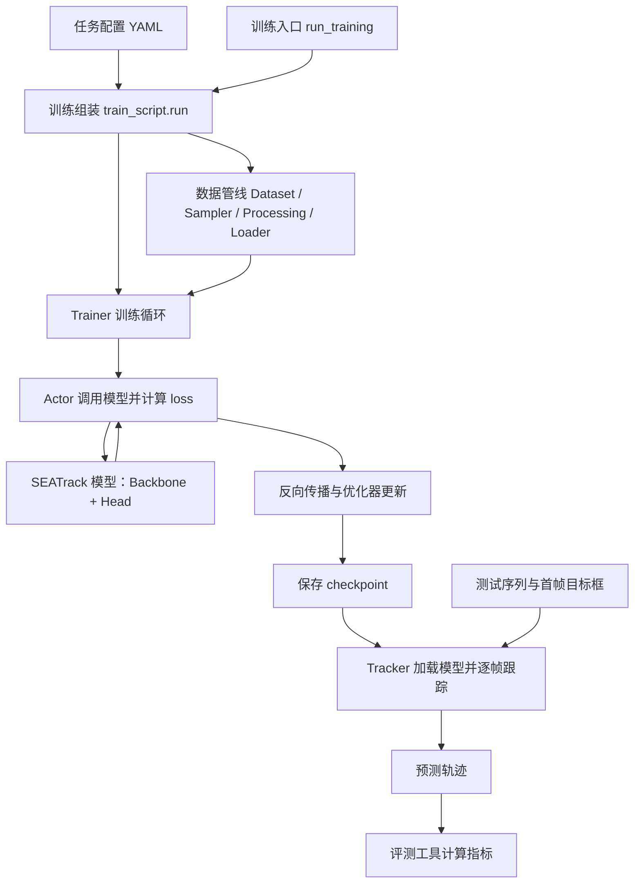

# SEATrack 源码导读与复现修改说明

核对日期：2026-10-12。依据本地源码、配置和已有复现记录；本次为静态阅读，未重新训练、评测或核验服务器当前状态。代码位置均指本地版本，服务器修补后的版本可能不同。


## 导航

- [代码框架与调用关系](#21-代码框架与调用关系)
- [模型与输入输出](#3-能把一次-forward-讲清楚)
- [AMG-LoRA 与 HMoE](#4-两个核心模块究竟做了什么)
- [训练流程](#5-训练数据可训练参数和-loss)
- [逐帧推理](#6-推理如何从一帧走到下一帧)
- [复现修改与源码对应关系](#9-复现修改与源码对应关系)
- [会前阅读顺序](#10-会前一小时阅读顺序)

## 1. 开场可以怎么讲

“我把代码按数据、模型、训练和推理四条线梳理了一遍。模型基于 OSTrack，用共享参数的 ViT 分别处理 RGB 和另一种模态，在第 2、4、6、8、10、12 个 block 加入 AMG-LoRA 和 HMoE。前者适配 K/V 并融合两路注意力 logits，后者做跨模态 token 混合；最后两路搜索特征相加，送入定位头。训练时主要更新 LoRA、HMoE 和对齐系数，基础骨干及预测头冻结。接下来我想确认，是优先补全复现，还是围绕对齐和融合做消融。”

注意：“统一框架”在当前配置中是同一套架构分别训练 RGB-T、RGB-D、RGB-E，不是一个 checkpoint 已联合学习三种任务。

## 2. 先认清目录和真正入口

| 位置 | 作用 | 阅读重点 |
|---|---|---|
| `SEATrack-main/` | 实际模型与训练评测代码 | 核心工作目录 |
| `experiments/seatrack/{rgbt,rgbd,rgbe}.yaml` | 三种任务的配置 | 数据、学习率、epoch、输入尺寸 |
| `tracking/train.py` → `lib/train/run_training.py` → `lib/train/train_script.py` | 训练启动链 | 加载配置、构建模型、Actor、优化器、Trainer |
| `lib/train/dataset/`、`lib/train/data/` | 读数据、采样、裁剪、增强 | 两路图像对应关系、标注和输入尺寸 |
| `lib/models/seatrack/seatrack.py` | 模型组装 | `build_seatrack()`、`forward()`、`forward_head()` |
| `lib/models/seatrack/vit_ci.py` | 实际使用的双流骨干 | 不要被同目录 `vit_ce.py` 等文件分散注意力 |
| `lib/models/layers/attn_blocks.py`、`attn.py` | 方法核心 | 对齐、LoRA、HMoE |
| `lib/train/actors/seatrack.py` | 模型前向与 loss 的衔接 | Actor 不是网络层，而是训练任务包装 |
| `lib/test/tracker/seatrack.py` | 实际逐帧跟踪 | 首帧初始化、搜索区域、坐标映射 |
| `RGBT_workspace/`、`RGBE_workspace/`、`lib/test/vot/` | 不同数据集的评测接入 | 数据协议及结果输出 |
| 根目录 `scripts/`、`result/`、`复现日志.md` | 本地复现辅助与证据 | 与算法实现分开理解 |

上表路径除特别注明外均相对 `SEATrack-main/`。快速跳转：[模型入口](./SEATrack-main/lib/models/seatrack/seatrack.py)、[双流骨干](./SEATrack-main/lib/models/seatrack/vit_ci.py)、[核心 block](./SEATrack-main/lib/models/layers/attn_blocks.py)。

### 2.1 代码框架与调用关系

**代码框架讲的是各部分如何分工和调用；模型结构讲的是神经网络内部如何计算。** AMG-LoRA、HMoE 属于模型结构，而数据读取、训练循环、权重保存和评测脚本共同构成整个项目的代码框架。

可以先把工程理解为五部分：**入口决定跑什么，数据模块准备输入，模型负责预测，训练模块负责学习，跟踪与评测模块负责在视频上运行并检验结果。**



图中的 checkpoint 是保存下来的模型文件。训练时会反复执行预测、计算误差和更新参数；测试时加载权重进行预测，不再用真实框更新模型。

### 2.2 目录按职责怎么分

下面只列与当前 SEATrack 主流程有关的目录，不是全部文件清单。

```text
seatrack/
├── README.md                      复现操作说明
├── Codebase讨论准备.md             本文：源码框架与修改说明
├── 复现日志.md                     历史执行过程和证据
├── scripts/                       本次复现的辅助脚本
├── result/                        已归档的评测结果
└── SEATrack-main/                  算法代码主体
    ├── experiments/seatrack/       rgbt / rgbd / rgbe 任务配置
    ├── tracking/                  训练启动、路径配置等入口
    ├── lib/
    │   ├── config/seatrack/        默认配置及 YAML 加载逻辑
    │   ├── models/
    │   │   ├── seatrack/           模型组装与 ViT 骨干
    │   │   └── layers/             注意力、LoRA、HMoE、定位头
    │   ├── train/
    │   │   ├── dataset/            按数据集格式读图像和标注
    │   │   ├── data/               采样、裁剪、增强、组成 batch
    │   │   ├── actors/             模型预测与 loss 计算
    │   │   ├── trainers/           训练循环、更新、验证和保存
    │   │   └── admin/              环境路径、运行设置和日志支持
    │   ├── test/
    │   │   ├── parameter/          测试配置和权重路径
    │   │   ├── tracker/            初始化、逐帧跟踪、状态更新
    │   │   ├── evaluation/         评测基础设施和环境配置
    │   │   └── vot/                与 VOT 评测工具的接入
    │   └── utils/                 框坐标、损失等公共工具
    ├── RGBT_workspace/            RGB-T 测试脚本
    ├── RGBE_workspace/            RGB-E 测试脚本
    ├── Depthtrack_workspace/      DepthTrack 的 VOT 工作区
    └── VOT22RGBD_workspace/       VOT22-RGBD 的 VOT 工作区
```

### 2.3 训练启动时：谁创建谁

通常的启动链是：

```text
tracking/train.py
  └─ 选择启动方式，启动 lib/train/run_training.py
       └─ 准备设备、随机种子、settings 和任务配置路径
            └─ lib/train/train_script.py::run(settings)
                 ├─ 读取默认配置，用任务 YAML 覆盖
                 ├─ build_dataloaders() → 训练 / 验证数据加载器
                 ├─ build_seatrack() → 模型，加载预训练初始化
                 ├─ SEATrackActor() → 绑定模型和损失函数
                 ├─ get_optimizer_scheduler() → 优化器与学习率策略
                 └─ LTRTrainer() → 开始按轮次训练
```

源码入口：[tracking/train.py](./SEATrack-main/tracking/train.py)、[run_training.py](./SEATrack-main/lib/train/run_training.py)、[train_script.py](./SEATrack-main/lib/train/train_script.py)。后续独立训练的 [run_task.py](./scripts/remaining_training/run_task.py) 直接通过分布式启动器调用 `run_training.py`，跳过外层 `tracking/train.py`；后面的训练组装逻辑相同。

配置有三种不同职责：

| 配置来源 | 管什么 | 例子 |
|---|---|---|
| [config.py](./SEATrack-main/lib/config/seatrack/config.py) | 提供默认值和配置加载规则 | 默认 rank、默认模型设置 |
| [任务 YAML](./SEATrack-main/experiments/seatrack/) | 覆盖本次任务的实验设置 | RGB-D 训练 25 轮，RGB-E 学习率 6e-5 |
| [训练环境 local.py](./SEATrack-main/lib/train/admin/local.py) 与启动参数 | 指定机器环境和输出位置 | 数据目录、`--save_dir`、GPU 环境变量 |

所以不能只看 `config.py` 的默认值就判断实际训练参数，还要看使用的 YAML 和运行副本。配置是否真正生效，还取决于对应构造函数有没有使用它，第 9 节的 rank 问题就是例子。

### 2.4 数据管线：dataset 和 data 为什么分开

可以把两者理解成“从硬盘取材料”和“把材料准备成模型输入”。

| 部件 | 负责什么 | 对应源码 |
|---|---|---|
| Dataset | 知道这个数据集的图片、模态和标注放在哪里，按帧读取 | [lasher.py](./SEATrack-main/lib/train/dataset/lasher.py)、[depthtrack.py](./SEATrack-main/lib/train/dataset/depthtrack.py)、[visevent.py](./SEATrack-main/lib/train/dataset/visevent.py) |
| TrackingSampler | 从序列中选出模板帧和搜索帧，考虑可见性与采样间隔 | [sampler.py](./SEATrack-main/lib/train/data/sampler.py) |
| seatrackProcessing | 根据目标框裁剪区域，缩放、增强，转换标注坐标 | [processing.py](./SEATrack-main/lib/train/data/processing.py) |
| LTRLoader | 把多个样本组成一个 batch，交给训练循环 | [loader.py](./SEATrack-main/lib/train/data/loader.py) |

送到 Actor 的数据中，重要字段包括 `template_images`、`search_images`、`template_anno`、`search_anno`。`anno` 是 annotation 的缩写，也就是标注。当前训练每个样本使用一个模板和一个搜索区域；Actor 将图像整理好后送入模型，使用搜索区域标注计算误差。

### 2.5 模型、Actor、Trainer 怎么区分

这是读训练框架时最容易混淆的三个角色。

| 角色 | 一句话职责 | 输入 → 输出 |
|---|---|---|
| Model：`SEATrack` | 看图并预测目标位置 | 模板、搜索图 → 框与预测图 |
| Actor：`SEATrackActor` | 调用模型，将预测与标注比较 | 一个 batch → loss 和统计值 |
| Trainer：`LTRTrainer` | 控制训练进度和参数更新 | 加载器、Actor、优化器 → 多轮训练和 checkpoint |

具体对应关系：

- [模型 SEATrack](./SEATrack-main/lib/models/seatrack/seatrack.py) 包含 `backbone` 和 `box_head`。前者提取并融合特征，后者完成定位预测。
- [SEATrackActor.__call__()](./SEATrack-main/lib/train/actors/seatrack.py) 先执行 `forward_pass()`，再执行 `compute_losses()`。
- [LTRTrainer.cycle_dataset()](./SEATrack-main/lib/train/trainers/ltr_trainer.py) 取 batch、调用 Actor，并在训练阶段执行反向传播、梯度裁剪和优化器更新。
- [BaseTrainer.train()](./SEATrack-main/lib/train/trainers/base_trainer.py) 管外层 epoch 循环、恢复 checkpoint、学习率调度和保存；`LTRTrainer` 在这个基类上实现具体的每轮训练。

一次训练迭代可以用下面的**示意代码**理解；真实实现还包含设备迁移、AMP、梯度裁剪和日志等处理：

```python
for batch in train_loader:
    loss, stats = actor(batch)  # 内部：模型 forward → 与真实框比较
    optimizer.zero_grad()
    loss.backward()            # 计算各可训练参数应如何调整
    optimizer.step()           # 实际更新参数
```

模型内部的组装关系则是：

```text
SEATrack（lib/models/seatrack/seatrack.py）
├── backbone：VisionTransformerCE（vit_ci.py）
│   ├── PatchEmbed：图片 → token
│   ├── 12 个 CEBlock_AP：两路特征处理
│   │   ├── 共享 Attention 与 MLP
│   │   └── 在指定层加入 LoRA、注意力对齐与 HMoE
│   └── 两路 search 特征相加
└── box_head：CenterPredictor（layers/head.py）
    └── 中心分数、尺寸、偏移及预测框
```

这里“共享”是指 RGB 和另一模态调用相同的层参数；12 个不同深度的 block 各自拥有参数，并不是 12 层都复用同一套权重。详见 [骨干](./SEATrack-main/lib/models/seatrack/vit_ci.py)、[block](./SEATrack-main/lib/models/layers/attn_blocks.py)、[定位头](./SEATrack-main/lib/models/layers/head.py)。

### 2.6 测试框架：Model 和 Tracker 也不是同一个东西

模型负责一次预测，而 Tracker 负责把这些预测连成一段视频的跟踪过程。

| 部分 | 职责 | 源码入口 |
|---|---|---|
| 参数入口 | 读取任务配置并选择权重 | [parameter/seatrack.py](./SEATrack-main/lib/test/parameter/seatrack.py) |
| Tracker | 保存首帧模板和上一帧框，裁剪当前搜索区域，调用模型，做后处理并更新状态 | [tracker/seatrack.py](./SEATrack-main/lib/test/tracker/seatrack.py) |
| 数据集测试脚本 / VOT 适配器 | 遍历视频帧，接入 Tracker，输出结果 | [RGB-T](./SEATrack-main/RGBT_workspace/test_rgbt_mgpus.py)、[RGB-E](./SEATrack-main/RGBE_workspace/test_rgbe_mgpus.py)、[VOT](./SEATrack-main/lib/test/vot/seatrack_baseline.py) |
| 指标分析 | 将预测结果与标注比较，计算数据集对应指标 | 结合数据集评测工具，已有产物见 [result](./result/README.md) |

特别注意：`lib/models/seatrack/seatrack.py` 与 `lib/test/tracker/seatrack.py` 都有名为 `SEATrack` 的类，但职责不同。前者是神经网络，后者是调用神经网络的跟踪程序。测试主流程不需要训练 Actor 和优化器。

### 2.7 后面要改功能，应该从哪里入手

| 想做什么 | 优先阅读 / 修改的位置 |
|---|---|
| 调学习率、训练轮数、batch | `experiments/seatrack/*.yaml`，再检查 `base_functions.py` 如何读取 |
| 换数据集或修正帧名 | `lib/train/dataset/`；数据集名称注册见 `base_functions.py::names2datasets()` |
| 改模板 / 搜索帧采样 | `lib/train/data/sampler.py` |
| 改裁剪、缩放、图像增强 | `lib/train/data/processing.py`、`transforms.py` |
| 改注意力对齐或融合 | `lib/models/layers/attn_blocks.py`、`attn.py` |
| 改损失函数 | `lib/train/actors/seatrack.py`，同时检查 `train_script.py` 的损失注册与权重 |
| 改保存、训练日志或训练循环 | `lib/train/trainers/` |
| 换测试权重 | `lib/test/parameter/seatrack.py`，核对最终解析路径 |
| 改搜索区域或跟踪后处理 | `lib/test/tracker/seatrack.py` 与任务 TEST 配置 |

向师兄介绍框架时可以这样说：

> 我把工程分成入口配置、数据管线、模型、训练控制和跟踪评测五部分。训练入口组装数据加载器、SEATrack 模型、Actor 和 Trainer。模型只负责预测，Actor 负责计算 loss，Trainer 负责循环和更新。测试时由 Tracker 管理模板与上一帧位置，调用同一个模型输出逐帧结果，再交给评测工具计算指标。

## 3. 能把一次 forward 讲清楚

默认配置是一张 template 加一张 search。template 是目标参考图，search 是待定位区域。

```text
template: [B, 6, 128, 128]       search: [B, 6, 256, 256]
           ↓ 前3通道RGB，后3通道另一模态 ↓
共享 PatchEmbed，patch=16，embedding=768
每个模态：template 64 tokens + search 256 tokens
           ↓
RGB: [B,320,768]       X: [B,320,768]
           ↓ 12 个 Transformer block，各层参数在两种模态间共享
第 2/4/6/8/10/12 层加入 AMG-LoRA 与 HMoE
           ↓
两路 search 特征逐元素相加：[B,256,768]
           ↓ reshape
定位特征图：[B,768,16,16]
           ↓ CENTER head
中心分数图、尺寸图、偏移图 → 边界框
```

这里的“双流”指两路特征，不是两套独立 ViT 权重。`patch_embed`、block 内的 `qkv` 和 MLP 都被两路调用。

输入的另一模态采用三通道图像表示；DepthTrack 默认使用深度伪彩色读取方式。不要描述成把原始深度单通道或原始事件流直接输入 ViT。

## 4. 两个核心模块究竟做了什么

### AMG-LoRA：低秩适配 + 注意力响应对齐

阅读 [attn.py:276](./SEATrack-main/lib/models/layers/attn.py#L276) 和 [attn_blocks.py:158](./SEATrack-main/lib/models/layers/attn_blocks.py#L158)。

- `enable_lora=[False, True, True]`：按 Q、K、V 排列，只对 K/V 添加 LoRA。
- `cal_qkv()` 分别计算两路的 `QKᵀ / √d` 和 V。
- `amglora_attn()` 在 softmax **之前**混合注意力 logits：`A_rgb_new = A_rgb + α × (A_x - A_rgb)`；另一方向有独立系数。
- 然后 softmax，再乘本模态的 V。不是直接把对方 V 替换过来，也不是显式执行跨模态 `Q_rgb K_xᵀ`。
- 两个 scaling 是可学习标量，初值为 1，没有 sigmoid 或区间约束。初始时对应直接使用对方 logits；训练后不保证是 0～1 的凸组合。

可以向师兄解释：“把另一模态关注的位置结构引入本模态，但保留本模态的 value 信息。”

### HMoE：通过专家槽位混合 token

阅读 [attn.py:78](./SEATrack-main/lib/models/layers/attn.py#L78) 和 [attn_blocks.py:213](./SEATrack-main/lib/models/layers/attn_blocks.py#L213)。

- 输入先归一化并低秩投影，再将每个 token 的通道分成两个 slots。
- Dispatch 在 token/slot 维度 softmax，将输入汇聚到专家槽位。
- 各专家进行低秩变换；Combine 在专家维度 softmax，将专家输出分配回 token。
- attention 后的 HMoE 使用 4 个专家，FFN 后的使用 8 个专家，slot 数均为 2，低秩维度均为 4。
- 这是软路由，不是只选 top-k 专家的稀疏路由。

一个容易说错的细节：调用时分别拼接“RGB template + X template”和“RGB search + X search”。**HMoE 单次调用内部混合的是同一区域的两种模态，没有把 template 与 search 一起拼进去。** template-search 交互已经存在于各流的自注意力中。`mode='template'/'search'` 传入 HMoE，但当前函数没有使用这个参数控制行为。

## 5. 训练：数据、可训练参数和 loss

```text
dataset 读取序列与标注
→ TrackingSampler 采样 template/search 帧
→ seatrackProcessing 裁剪、缩放、增强
→ LTRLoader 组成 batch
→ SEATrackActor.forward_pass()
→ 网络预测
→ SEATrackActor.compute_losses()
→ LTRTrainer 反向传播、更新、验证、保存
```

当前 loss 为 `2 × GIoU + 5 × L1 + 1 × focal`。虽然注册了 KLDivLoss，相关跨模态 loss 的计算和加权部分已注释，因此不要说当前训练显式加入了 KL 对齐损失。

[base_functions.py:171](./SEATrack-main/lib/train/base_functions.py#L171) 用参数名字中的 `moe`、`scaling`、`lora` 筛选训练参数，其余冻结。因此 HMoE 内的 norm、gate、bias 和温度参数也包含在训练范围内；不只是低秩矩阵。预测头参数冻结，`FIX_BN` 还会让其中 BatchNorm 保持 eval 状态。

| 配置 | RGB-T | RGB-D | RGB-E |
|---|---:|---:|---:|
| 训练数据 | LasHeR_train | DepthTrack_train | VisEvent |
| epoch | 60 | 25 | 45 |
| 初始学习率 | 4e-4 | 4e-4 | 6e-5 |
| 每进程 batch | 32 | 32 | 32 |
| 每 epoch 采样数 | 60000 | 60000 | 60000 |
| validation loader | 有 | 有 | 无 |

全局 batch 取决于实际进程数；两进程且每进程 32 时为 64。“60000”是采样对数量，不等于遍历全数据集每帧一次。三个配置的学习率下降点都为 48，所以默认 RGB-D 和 RGB-E 在各自训练结束前不会触发这次下降。

## 6. 推理：如何从一帧走到下一帧

阅读 [tracker/seatrack.py](./SEATrack-main/lib/test/tracker/seatrack.py)。

1. `initialize()`：根据首帧给定框裁剪 template 并缓存图像 tensor，保存目标状态。
2. `track()`：根据上一帧预测框裁剪当前帧 search。
3. 将缓存的 template 图像和当前 search 一起送入网络；不是只在首帧算一次 backbone template 特征。
4. 中心分数图乘 Hann window，对远离搜索中心的位置施加惩罚。
5. 结合尺寸、偏移图解码框，映射回原图并裁剪至合法边界。
6. 更新状态，供下一帧搜索使用；当前路径没有在线更新 template。

因此模型之外的搜索区域和后处理也是评测结果的一部分。若改 search factor 或移除 Hann window，也是在改变实验条件。

## 7. 下午值得讨论的实现问题

以下是本地源码确认的事实或有明确触发条件的风险，不能笼统说成“默认模型跑不通”。

| 观察 | 证据与影响 | 可讨论的下一步 |
|---|---|---|
| rank 参数未完整接通 | `attn_blocks.py:130` 将 AMG rank 固定为 8；145–146 行将 HMoE rank 固定为 4 | 做 rank 消融前先贯通参数，并检查实际参数形状与数量 |
| 默认 CE 不裁剪 | 三份 YAML 都是 `CE_KEEP_RATIO: [1,1,1]` | 不应把当前效率直接归因为 CE 裁剪 |
| 开启 CE 有确定的维度问题 | `attn_blocks.py:199–200` 将三维 token 当作第一参数传给需要四维 attention 的 `candidate_elimination()` | 若要启用裁剪，先修正输入，再考虑两模态保留位置的一致性 |
| checkpoint 依赖 LoRA 合并状态 | `MergedLinear.train(False)` 会将增量加进基础 weight；`merged` 只是 Python 状态，不在 state_dict 中 | 自训练权重应核验保存时状态，不能只靠任务名推断 |
| 测试 checkpoint 路径固定 | `lib/test/parameter/seatrack.py` 按 rgbt/rgbd/rgbe 固定选文件；函数的 epoch/variants 未用于当前有效路径 | 显式记录实际加载路径和权重 hash，结果目录名不能证明权重来源 |
| attention 可视化接口不完整 | `vit_ci.py` 创建 `attns=[]`，追加逻辑被注释；tracker 的 debug 分支却索引它 | 做对齐可视化前接通返回值，并明确画 logits 还是 softmax 权重 |

LoRA 合并状态尤其值得理解：训练器先训练，再在指定 epoch 验证，随后保存。RGB-T/D 有验证，最终保存轮次又恰好是验证轮次，因此当前 tracker 针对它们先标记 merged，再调用 train 拆分，最后 eval 合并。这是对特定保存流程的约定。更换保存 epoch、验证策略或 checkpoint 来源后，不能保证约定仍然成立。

## 8. 怎样汇报现有进度

依据仓库记录，而非本次实时服务器检查：

- 官方 RGB-D → DepthTrack：已有结果归档，50 序列，PR/RE/F 为 62.9/63.5/63.2。
- 官方 RGB-T → LasHeR：记录为用户回传完成，PR/NPR/SR 为 71.5961/67.4782/57.2631；完整文件待归档。
- VisEvent：最新记录是 320 序列结构和数量检查通过，已给出单序列试跑命令，尚不能声称全量评测完成。
- 自训练 RGB-D：日志记录已生成第 25 轮权重，且后续针对与官方结果相同的问题有多次修正。汇报时应连同权重对照和评测来源证据讲，不沿用早期已撤回的判断。

证据入口：[结果索引](./result/README.md)、[复现日志](./复现日志.md)。

## 9. 复现修改与源码对应关系

### 9.1 阅读范围与版本区别

本次复现沿用主要模型结构和训练超参数，调整集中在权重保存、运行配置及工程修复。这里的“手动调参”与训练时优化器自动更新模型权重是两回事。

需要区分三个位置：

- **仓库源码**：`SEATrack-main/`，包含当前入库的模型和部分评测修复。
- **服务器 RGB-D 工程**：保存间隔改为 5 的记录来自有效配置回传；仓库中的 `rgbd.yaml` 仍是 25。
- **服务器 RGB-T/E 独立训练副本**：由 [configure.py](./scripts/remaining_training/configure.py) 创建并修改；仓库保留修改脚本，不代表所有修改已直接写回 `SEATrack-main/`。

下列链接使用 GitHub 支持的仓库相对路径与 `#L` 行号；行号对应本次整理版本。历史执行证据见 [复现日志](./复现日志.md)，独立训练设置见 [运行说明](./scripts/remaining_training/README.md)。

### 9.2 已调整的配置及其执行位置

| 调整 | 原值 → 复现设置 | 配置或修改入口 | 实际由哪段源码执行 | 证据范围 |
|---|---|---|---|---|
| RGB-D 保存间隔 | 25 → 5 轮 | [rgbd.yaml](./SEATrack-main/experiments/seatrack/rgbd.yaml#L70) 的 `TRAIN.SAVE_EPOCH_INTERVAL` | [train_script.py](./SEATrack-main/lib/train/train_script.py) 传入 settings；[BaseTrainer.train](./SEATrack-main/lib/train/trainers/base_trainer.py#L92) 判断轮次后保存 | 日志有用户回传的有效配置；仓库 YAML 仍为 25 |
| RGB-T/E 保存间隔 | 60 / 45 → 1 轮 | [configure.py](./scripts/remaining_training/configure.py#L18) 修改独立副本 YAML | 同上，命中保存条件后调用 `save_checkpoint()` | 日志记录配置脚本已执行；不表示两项训练均已完成 |
| RGB-E 测试轮次字段 | `TEST.EPOCH: 60` → `45` | [configure.py](./scripts/remaining_training/configure.py#L23) | [parameter/seatrack.py](./SEATrack-main/lib/test/parameter/seatrack.py) 当前仍按任务固定选择 checkpoint 路径 | 配置一致性修正；这个字段本身不能切换当前测试权重 |
| 异常处理 | `fail_safe=True` → `False` | [configure.py](./scripts/remaining_training/configure.py#L25) 修改训练入口 | [BaseTrainer.train](./SEATrack-main/lib/train/trainers/base_trainer.py#L100) 的异常分支将错误重新抛出 | 作用于 RGB-T/E 独立副本；仓库训练入口仍为 True |
| 训练 GPU | RGB-D 选 0、1；后续 RGB-E 选 5、6 | 启动环境 `CUDA_VISIBLE_DEVICES` | [run_task.py](./scripts/remaining_training/run_task.py#L139) 设置环境并启动两个训练进程 | 来自历史启动记录，不代表当前实时占用 |
| 数据与输出路径 | 作者路径 → 实际数据目录和独立输出目录 | [configure.py](./scripts/remaining_training/configure.py#L12)、训练启动的 `--save_dir` | [local.py](./SEATrack-main/lib/train/admin/local.py)、[base_functions.py](./SEATrack-main/lib/train/base_functions.py) 中的数据集构建与训练保存逻辑 | 运行环境适配，不是模型结构调整 |

保存间隔的含义可以直接从下面的源码理解（节选）：

```python
save_epoch_interval = getattr(self.settings, "save_epoch_interval", 1)
save_last_n_epoch = getattr(self.settings, "save_last_n_epoch", 1)
if epoch > (max_epochs - save_last_n_epoch) or epoch % save_epoch_interval == 0:
    # 满足目录和主进程条件后调用 self.save_checkpoint()
    ...
```

把间隔改为 5，就是在第 5、10、15……轮保存；改为 1，就是每轮保存。最后若干轮还有单独保存条件。这项改动本身不改变前向计算、loss 或学习率。

### 9.3 保持原值的训练参数：配置如何进入源码

| 参数 | RGB-D / RGB-T / RGB-E | 源码关系 |
|---|---|---|
| `TRAIN.EPOCH` | 25 / 60 / 45 | [train_script.py](./SEATrack-main/lib/train/train_script.py) → `trainer.train(cfg.TRAIN.EPOCH, ...)`，决定训练轮数 |
| `TRAIN.LR` | 4e-4 / 4e-4 / 6e-5 | [get_optimizer_scheduler()](./SEATrack-main/lib/train/base_functions.py#L171) → `AdamW(..., lr=cfg.TRAIN.LR)`，决定更新步长 |
| `TRAIN.BATCH_SIZE` | 均为每进程 32 | [build_dataloaders()](./SEATrack-main/lib/train/base_functions.py#L99) → `LTRLoader(..., batch_size=cfg.TRAIN.BATCH_SIZE)`；两进程总 batch 为 64 |
| `TRAIN.PEFT` | 均为 True | [get_optimizer_scheduler()](./SEATrack-main/lib/train/base_functions.py#L171) 按 `moe`、`scaling`、`lora` 名称筛选可训练参数，其余冻结 |
| `TRAIN.AMP` | 均为 False | [train_script.py](./SEATrack-main/lib/train/train_script.py) 传入 Trainer；[ltr_trainer.py](./SEATrack-main/lib/train/trainers/ltr_trainer.py) 控制 autocast 和 GradScaler |
| `GIOU_WEIGHT` / `L1_WEIGHT` | 均为 2 / 5 | [Actor.compute_losses()](./SEATrack-main/lib/train/actors/seatrack.py#L90) 使用权重求和；focal 权重在训练入口设为 1 |
| `DATA.TEMPLATE.SIZE` / `DATA.SEARCH.SIZE` | 均为 128 / 256 | [base_functions.py](./SEATrack-main/lib/train/base_functions.py) 将裁剪尺寸交给 [processing.py](./SEATrack-main/lib/train/data/processing.py)，并影响模型位置编码与输出特征尺寸 |
| HMoE / AMG-LoRA rank | 4 / 8，未做取值消融 | [CEBlock_AP](./SEATrack-main/lib/models/layers/attn_blocks.py#L124) 当前直接写死这两个值；测试脚本传参修复不等于改变模型 rank |

配置原文：[RGB-D](./SEATrack-main/experiments/seatrack/rgbd.yaml)、[RGB-T](./SEATrack-main/experiments/seatrack/rgbt.yaml)、[RGB-E](./SEATrack-main/experiments/seatrack/rgbe.yaml)。后续 RGB-T/E 启动还显式指定 `--seed 0`，见 [run_task.py](./scripts/remaining_training/run_task.py#L140)，没有进行随机种子扫描。

### 9.4 工程修复：改的是哪段代码

| 修复内容 | 对应源码 | 原因与修改范围 |
|---|---|---|
| sequential 分支补传参数 | [RGB-T 测试入口](./SEATrack-main/RGBT_workspace/test_rgbt_mgpus.py#L196)、[RGB-E 测试入口](./SEATrack-main/RGBE_workspace/test_rgbe_mgpus.py#L144) | 补传 `variants`、`hmoe_rank`、`amglora_rank`，避免默认空字符串导致 `int('')` 报错；两处修复已在仓库源码体现 |
| 项目导入路径与 GPU 继承 | [VOT baseline](./SEATrack-main/lib/test/vot/seatrack_baseline.py#L1) | 项目目录优先加入 Python 搜索路径，移除内部强制选择 GPU 的语句，让子进程继承启动环境 |
| RGB-E 数据目录可配置 | [RGB-E 测试入口](./SEATrack-main/RGBE_workspace/test_rgbe_mgpus.py#L117) | 仓库版新增 `--data_root`；日志中的服务器旧版本曾直接修正路径，不能假设两个版本接口完全相同 |
| LasHeR 精确帧索引 | [原读取函数](./SEATrack-main/lib/train/dataset/lasher.py#L87)、[副本修改脚本](./scripts/remaining_training/configure.py#L26) | 原 `*5.jpg` 可能同时匹配 `15.jpg` 等文件；独立副本改为提取完整数值 ID、检查重复和两模态配对，再按 ID 取图；仓库原读取函数仍保留后缀匹配 |
| 自训练 RGB-D 选权重 | [当前参数入口](./SEATrack-main/lib/test/parameter/seatrack.py)、[复现日志](./复现日志.md) | 日志记录服务器加入 `SEATRACK_RGBD_CHECKPOINT` 覆盖路径并通过参数预检；当前仓库参数文件没有该覆盖逻辑，不应宣称已入库 |

### 9.5 汇报表述

> 目前沿用仓库的主要模型结构和训练超参数，没有进行学习率、batch size 或 rank 的精度调参。复现中主要调整了权重保存间隔、GPU 与文件路径，并修复了参数传递、帧读取和评测接入问题。其中一部分修复直接在仓库源码中，另一部分由配置脚本作用于服务器独立训练副本，文档中分别标明了位置和证据。

## 10. 会前一小时阅读顺序

1. 10 分钟：看 `rgbd.yaml`、模型入口，记住输入、输出、冻结策略。
2. 15 分钟：看 `vit_ci.forward_features()`，把维度和共享参数画出来。
3. 20 分钟：看 `CEBlock_AP.forward()`、`amglora_attn()`、`HMoE.forward()`，讲清两个创新模块。
4. 10 分钟：看 Actor loss、optimizer 和 tracker 初始化/逐帧跟踪。
5. 5 分钟：挑两三个实现问题和下一步实验，与师兄确认优先级。

建议带去的三个问题：

- 接下来以“补齐多数据集复现”为主，还是以“找到可改进点”为主？
- 是否先做去除注意力对齐、去除 HMoE 的受控消融，再考虑更复杂改动？去掉任一模块后应重新训练可比模型；仅在推理时关闭模块只能视为干预实验。
- 若研究鲁棒性，是优先做模态质量退化、模态缺失，还是空间错位？当前共享坐标裁剪和 token 对齐的实现，使空间错位是一个值得检验的假设，但尚无本次实验支持。
