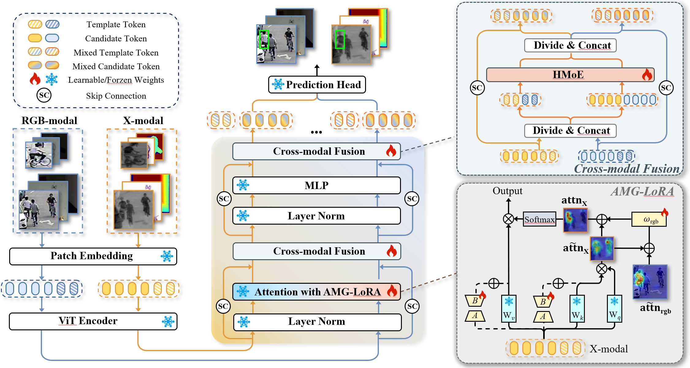
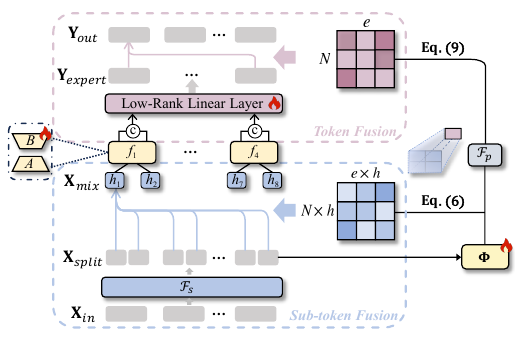

# SEATrack：一个样本如何从图片变成目标框

> 核对日期：2026-10-13。依据仓库中的论文图 2、图 3、式 (1)–(11) 与本地源码逐项整理。本文解释默认配置的计算路径，不代表本次实际运行了训练或 checkpoint 推理。数值演算均为教学示例，不是实验输出。服务器独立训练副本的修改另见 [复现修改说明](./Codebase讨论准备.md)。

**阅读目标：能指着论文流程图说出每一步的输入、计算、输出，能在源码中找到这一行，并知道改动会影响后面的什么。**

本文以 **RGB + 热红外、一个样本 `B=1`** 为例。RGB-D、RGB-E 在读入第二种模态时不同，进入网络后的主结构相同。先沿推理走完整条路径，再解释训练时如何计算损失和更新参数。

## 目录

- [1. 先认图和文件](#s1)
- [2. 一个样本究竟是什么](#s2)
- [3. 裁剪和归一化](#s3)
- [4. Patch Embedding：图片变成 token](#s4)
- [5. 一个 Transformer block 的执行顺序](#s5)
- [6. AMG-LoRA：公式与代码逐行对应](#s6)
- [7. HMoE：公式与代码逐步对应](#s7)
- [8. 最终融合与预测头](#s8)
- [9. 从网络输出回到原图目标框](#s9)
- [10. 训练时：从预测误差到参数更新](#s10)
- [11. 论文公式、变量、源码总索引](#s11)
- [12. 后续怎么改，改动怎样验证](#s12)
- [13. 实际看代码与汇报的顺序](#s13)

<a id="s1"></a>
## 1. 先认图和文件

### 1.1 按论文图 2 读整个模型



来源：仓库内 SEATrack 论文图 2，PDF 第 4 页；使用项目已有的 `Framework.png`。原文见 [论文 PDF](./SEATrack：%20Simple,%20Efficient,%20and%20Adaptive%20Multimodal%20Tracker.pdf)。

图从左下向中间、再向上读：

| 图中位置 / 名称 | 在做什么 | 实际源码 |
|---|---|---|
| 左侧 RGB-modal / X-modal | 各有模板与搜索图；X 是热红外、深度或事件图像表示 | [vit_ci.py：拆通道](./SEATrack-main/lib/models/seatrack/vit_ci.py#L123) |
| Patch Embedding | 把每个图块映射为 768 维特征 | [patch_embed.py：PatchEmbed](./SEATrack-main/lib/models/layers/patch_embed.py#L6) |
| ViT Encoder | 共 12 个 block，不是只有图中画出来的一个 | [vit_ci.py：创建 blocks](./SEATrack-main/lib/models/seatrack/vit_ci.py#L96) |
| 中间 Layer Norm | 对每个 token 的通道归一化 | [attn_blocks.py：norm1 / norm2](./SEATrack-main/lib/models/layers/attn_blocks.py#L129) |
| Attention with AMG-LoRA / 右下放大图 | 生成 Q/K/V、适配 K/V、互相引导注意力 logits | [cal_qkv / amglora_attn](./SEATrack-main/lib/models/layers/attn_blocks.py#L158) |
| 两处 Cross-modal Fusion / 右上放大图 | 模板与模板融合，搜索与搜索融合，然后分回两路 | [CEBlock_AP.forward](./SEATrack-main/lib/models/layers/attn_blocks.py#L213) |
| MLP | 对每个 token 做通道变换 | [attn_blocks.py](./SEATrack-main/lib/models/layers/attn_blocks.py#L242) |
| SC / 绕行箭头 | 残差连接：原特征加新分支输出 | [attn_blocks.py](./SEATrack-main/lib/models/layers/attn_blocks.py#L210) |
| 最上方 Prediction Head | 两路搜索特征相加，预测目标中心、尺寸和偏移 | [vit_ci.py](./SEATrack-main/lib/models/seatrack/vit_ci.py#L238)、[head.py](./SEATrack-main/lib/models/layers/head.py#L102) |
| 雪花 / 火焰 | 参数冻结 / 可训练 | [get_optimizer_scheduler](./SEATrack-main/lib/train/base_functions.py#L171) |

注意：图中 token 数量只是示意；图形排列也不能直接当作源码 token 顺序。默认代码的顺序是 **模板在前、搜索在后**。

### 1.2 先只打开这条主链

```text
lib/test/tracker/seatrack.py             管视频状态、裁图、后处理
  └─ lib/models/seatrack/seatrack.py     组装模型，调用 backbone 和 head
       ├─ lib/models/seatrack/vit_ci.py  拆分模态，依次执行 12 个 block
       │    ├─ lib/models/layers/patch_embed.py
       │    └─ lib/models/layers/attn_blocks.py
       │         └─ lib/models/layers/attn.py   LoRA / HMoE 的具体计算
       └─ lib/models/layers/head.py      特征图 → 分数、尺寸、偏移、框
```

上述路径相对 `SEATrack-main/`。同目录的 `vit_ce.py`、`ostrack.py` 不是当前 `build_seatrack()` 的主骨干路径。两个 `seatrack.py` 中的 `SEATrack` 类也不同：`models` 里的是神经网络，`test/tracker` 里的是管理连续帧的跟踪程序。

<a id="s2"></a>
## 2. 一个样本究竟是什么

假设第一帧指定一个行人为目标，现在处理第 $t$ 帧。实际用到四张小图：

| 图片 | 来源 | 告诉网络什么 |
|---|---|---|
| RGB 模板 | 第一帧目标附近的彩色图 | 要找的人长什么样 |
| X 模板 | 第一帧对应的热红外区域 | 同一个目标在热红外里是什么样 |
| RGB 搜索图 | 当前帧、上一帧预测位置附近 | 当前要在这里找 |
| X 搜索图 | 当前帧对应的热红外区域 | 第二种模态提供的当前线索 |

两种模态沿**通道维**拼接，组成两个输入：

```text
z = template: [1, 6, 128, 128]
x = search:   [1, 6, 256, 256]
                ↑
              3 RGB + 3 X
```

这里并不是将两张图片左右拼接成更宽的一张图，也不是先把 RGB 与热红外像素相加。进入骨干后马上按前三通道、后三通道拆开。

### 本文符号表

| 符号 | 含义 | 默认值 / 对应变量 |
|---|---|---|
| $B$ | 一个 batch 的样本数 | 本文取 1；与 LoRA 矩阵 B 区分 |
| $D$ | 一个 token 的特征长度 | 768；代码有时命名为 C |
| $P$ | patch 边长 | 16 |
| $N_z,N_s$ | 每个模态的模板 / 搜索 token 数 | 64 / 256 |
| $L$ | 每路模板和搜索合起来的长度 | 320 |
| $n_a,d_a$ | 自注意力头数 / 每头维度 | 12 / 64 |
| $e,h,r$ | HMoE 专家数 / slots 数 / 低秩维度 | 4 或 8 / 2 / 4 |
| $N$ | 单次 HMoE 输入的 token 数 | 两路模板 128，或两路搜索 512 |
| $z,c$ | 论文模板 / candidate 特征 | 代码常写 `z_*` / `x_*` |
| X / `dte` | 第二种模态 | depth / thermal / event，不是三种同时输入 |

**不要混淆自注意力的 12 个 head 和 HMoE 的 2 个 slots（论文也称 head）。它们属于不同模块。**

<a id="s3"></a>
## 3. 裁剪和归一化：forward 之前发生了什么

**对应文件：**[tracker.initialize / track](./SEATrack-main/lib/test/tracker/seatrack.py#L49)、[sample_target](./SEATrack-main/lib/train/data/processing_utils.py#L15)、[PreprocessorMM](./SEATrack-main/lib/test/tracker/data_utils.py#L20)。

### 3.1 围绕目标裁正方形

原图框采用 $[x_0,y_0,w,h]$，即左上角和宽高。裁剪边长为：

$$
S=\left\lceil f\sqrt{wh}\right\rceil,\qquad
(c_x,c_y)=(x_0+w/2,\ y_0+h/2).
$$

以 $(c_x,c_y)$ 为中心裁 $S\times S$，越界部分补零，再缩放到指定尺寸。代码节选：

```python
crop_sz = math.ceil(math.sqrt(w * h) * search_area_factor)
x1 = round(x + 0.5 * w - crop_sz * 0.5)
y1 = round(y + 0.5 * h - crop_sz * 0.5)
resize_factor = output_sz / crop_sz
```

默认模板 $f=2$、输出 128；搜索 $f=4$、输出 256。它是按目标面积的平方根决定正方形边长，**不是简单将原框的宽和高分别乘 4**。

教学示例：上一帧框为 `[100, 80, 40, 80]`。中心为 `(120,120)`，搜索边长为 $\lceil4\sqrt{3200}\rceil=227$，缩放比例 $\rho=256/227$。搜索区域包含目标及周边背景，让模型有空间发现运动后的目标。

### 3.2 数字归一化

像素值先除以 255，再按通道减均值、除标准差：

$$
I'_{cij}=\frac{I_{cij}/255-\mu_c}{\sigma_c}.
$$

前三通道使用 $(0.485,0.456,0.406)$ 和 $(0.229,0.224,0.225)$，后三通道重复这组数。`PreprocessorMM.process()` 把 `[H,W,6]` 变成 `[1,6,H,W]`。

第二模态不是直接把任意原始传感器数据塞进去：训练注册中，DepthTrack 使用 `rgbcolormap` 深度伪彩色，LasHeR / VisEvent 使用 `rgbrgb` 图像读取。见 [names2datasets](./SEATrack-main/lib/train/base_functions.py#L29)、[depth_utils.py](./SEATrack-main/lib/train/dataset/depth_utils.py)。

**训练与测试的区别：**测试按第一帧框取固定模板，按上一帧预测框取搜索区域；训练通过 sampler 选帧，围绕标注框加入裁剪扰动和增强。训练模板不一定是视频第一帧，搜索帧也不要求紧邻模板帧。见 [sampler.getitem](./SEATrack-main/lib/train/data/sampler.py#L101)、[processing](./SEATrack-main/lib/train/data/processing.py#L87)。

<a id="s4"></a>
## 4. Patch Embedding：图片变成 token

**对应图 2：**左下 Patch Embedding。**对应文件：**[vit_ci.forward_features](./SEATrack-main/lib/models/seatrack/vit_ci.py#L114)、[PatchEmbed.forward](./SEATrack-main/lib/models/layers/patch_embed.py#L26)。

### 4.1 先拆模态

```python
x_rgb = x[:, :3, :, :]
z_rgb = z[:, :3, :, :]
x_dte = x[:, 3:, :, :]
z_dte = z[:, 3:, :, :]
```

得到 RGB/X 各一张 `[1,3,128,128]` 模板和 `[1,3,256,256]` 搜索图。

### 4.2 一个图块怎样变成一个向量

数学上，每个 $16\times16\times3$ 图块展平为 768 个像素数，通过一个线性映射成为 768 维 token：

$$
t_i = \mathrm{vec}(I_i) W_E + b_E
$$

纯文本对照：`第 i 个 token = 第 i 个图块展平后的向量 × 投影矩阵 W_E + 偏置 b_E`。

输入像素数和输出维度恰好都为 768，但含义不同：前者是原始颜色值，后者是学出来的特征坐标。代码用卷积同时完成所有不重叠图块的映射：

```python
self.proj = nn.Conv2d(in_chans, embed_dim,
                      kernel_size=patch_size, stride=patch_size)
# forward:
x = self.proj(x)
x = x.flatten(2).transpose(1, 2)
```

| 图片 | 卷积后 | 展平、转置后 |
|---|---|---|
| 模板 `[1,3,128,128]` | `[1,768,8,8]` | `[1,64,768]` |
| 搜索 `[1,3,256,256]` | `[1,768,16,16]` | `[1,256,768]` |

四张图调用同一个 `self.patch_embed`，参数共享。

### 4.3 加位置，再把模板与搜索连接

$$
Z_m = \mathrm{PatchEmbed}(I_m^z) + P_z
$$

$$
C_m = \mathrm{PatchEmbed}(I_m^s) + P_s
$$

$$
H_m = [Z_m; C_m]
$$

纯文本对照：

```text
模板特征 Z_m = PatchEmbed(模板图) + 模板位置编码 P_z
搜索特征 C_m = PatchEmbed(搜索图) + 搜索位置编码 P_s
拼接特征 H_m = 沿 token 维连接 Z_m 和 C_m
H_m 的形状 = [B, 64 + 256, 768] = [B, 320, 768]
```

$m$ 代表 RGB 或 X。位置编码让模型知道 token 的空间位置；`P_z`、`P_s` 在两模态间共享。

源码：[vit_ci.py](./SEATrack-main/lib/models/seatrack/vit_ci.py#L151)、[combine_tokens](./SEATrack-main/lib/models/seatrack/utils.py#L7)。

```python
z_rgb += self.pos_embed_z
x_rgb += self.pos_embed_x
z_dte += self.pos_embed_z
x_dte += self.pos_embed_x
x_rgbs = combine_tokens(z_rgb, x_rgb, mode=self.cat_mode)
x_dtes = combine_tokens(z_dte, x_dte, mode=self.cat_mode)
# direct 模式内部：torch.cat((template_tokens, search_tokens), dim=1)
```

**拼接增加的是 token 个数：64+256=320，不是把特征维变成 1536。** 当前路径不添加 CLS token。

<a id="s5"></a>
## 5. 一个 Transformer block 的执行顺序

**对应图 2：**中间从下往上的结构。**对应文件：**[CEBlock_AP.forward](./SEATrack-main/lib/models/layers/attn_blocks.py#L191)。

12 层的参数在不同层之间不共享，但每一层的 RGB/X 两路共享该层参数。零起始索引 `[1,3,5,7,9,11]`，即第 2、4、6、8、10、12 层，包含 AMG-LoRA 与两处 HMoE。

对其中一个增强 block，可以写成下面四步。这里 $\mathrm{DP}$ 是训练时的 DropPath，推理时等同于直接通过：

$$
U_m=H_m+\mathrm{DP}\bigl(\mathrm{AMGAttn}_m(\mathrm{LN}(H_{rgb}),\mathrm{LN}(H_X))\bigr),
$$

$$
V_m=U_m+\mathrm{DP}\bigl(\mathrm{SplitBack}_m(\mathrm{HMoE}_{attn}(U_{rgb},U_X))\bigr),
$$

$$
W_m=V_m+\mathrm{DP}\bigl(\mathrm{MLP}(\mathrm{LN}(V_m))\bigr),
$$

$$
H'_m=W_m+\mathrm{DP}\bigl(\mathrm{SplitBack}_m(\mathrm{HMoE}_{ffn}(W_{rgb},W_X))\bigr).
$$

这里 HMoE 的双输入写法只是总流程简写：实际先分别取模板和搜索，拼成两次调用，下一节会拆开说明。

| 操作 | 数学含义 | 对应代码 |
|---|---|---|
| LayerNorm | 每个 token 在 768 个通道内做归一化，再做可学习缩放与平移 | `self.norm1(x[0])`、`self.norm2(x[0])` |
| Attention 残差 | 原特征 + 注意力提供的新信息 | `x[0] = x[0] + self.drop_path(xrgb_attn)` |
| HMoE 残差 | 原特征 + 跨模态混合结果 | `x[0] = x[0] + self.drop_path(torch.cat(...))` |
| MLP / FFN | 每个 token 独立做 `768 → 3072 → 768`，中间 GELU | `self.mlp(self.norm2(x[0]))` |

LayerNorm 的核心是 $\gamma\odot(u-\mu)/\sqrt{\sigma^2+\epsilon}+\beta$。MLP 改变的是单个 token 的通道表示；让不同位置交换信息主要依靠注意力和 HMoE。

没有增强模块的层仍进行两路独立的自注意力和 MLP。默认三份 YAML 的 `CE_KEEP_RATIO=[1,1,1]`，因此下文都按**不裁剪 token**计算，长度一直是 320。不要仅凭类名带 CE 就认为默认启用了候选裁剪。

<a id="s6"></a>
## 6. AMG-LoRA：公式与代码逐行对应

### 6.1 先理解 Q、K、V 在干什么

对归一化后的每路输入 $\bar H_m=\mathrm{LN}(H_m)$，计算：

$$
Q_m=\bar H_mW_Q+b_Q,
$$

$$
K_m=\bar H_mW_K+b_K+\bar H_m A_KB_K,\qquad
V_m=\bar H_mW_V+b_V+\bar H_m A_VB_V.
$$

这是对应论文式 (1) 的按实现补充写法：省略了训练态 dropout；论文重点写 K，V 也有独立的低秩适配。

- **Q（query）**：某个位置想找怎样的信息。
- **K（key）**：各个位置用来与 Q 比较的描述。
- **V（value）**：匹配后真正被汇总的信息。

这些只是帮助理解的角色，三者都是由输入特征算出的数值，并没有人为写入“人”“背景”这样的标签。

### 6.2 LoRA 为什么省参数

普通 $768\times768$ 的新增矩阵有 589,824 个参数。LoRA 把新增变换写为：

$$
\Delta W=A B,\qquad A\in\mathbb R^{768\times8},\quad B\in\mathbb R^{8\times768}.
$$

一个投影的新增参数只有 $768\times8+8\times768=12,288$。K 和 V 各有一组；Q 不加。六个增强层的 K/V LoRA 矩阵合计 $6\times2\times12,288=147,456$ 个参数，尚未包含引导标量和 HMoE。

**源码入口：**[Attention.__init__](./SEATrack-main/lib/models/layers/attn.py#L276)、[MergedLinear](./SEATrack-main/lib/models/layers/attn.py#L160)。

```python
self.qkv = MergedLinear(dim, dim * 3, r=amglora_rank,
                       lora_alpha=1, lora_dropout=0.1,
                       bias=qkv_bias, enable_lora=[False, True, True])
```

`[False, True, True]` 对应 Q、K、V。PyTorch 的权重存储为 `[out,in]`，因此代码里合并的 `lora_A` 是 `[16,768]`，`lora_B` 是 `[1536,8]`；分组运算分别计算 K/V 的增量，Q 对应部分补零，得到 `[2304,768]`。不要把论文矩阵的转置存储误认为算法不同。

[forward](./SEATrack-main/lib/models/layers/attn.py#L265) 的关键部分：

```python
result = F.linear(x, T(self.weight), bias=self.bias)
result += self.lora_dropout(x @ T(self.merge_AB().T))
```

实现细节：当前代码虽定义 `self.scaling = lora_alpha / r`，实际乘法被注释，因此这里**没有乘常见的 LoRA alpha/r 系数**。它也不是后面 AMG 的两个可学习 scaling。LoRA A 为 Xavier 初始化、B 为零初始化，所以初始低秩增量为零；不要说 A/B 两个都随机非零。

### 6.3 从 Q/K 得到注意力分数：论文式 (2)

每路 `qkv` 先得到 `[1,320,2304]`，随后拆成 3 组，再拆成 12 个注意力头：

```python
qkv = self.attn.qkv(x)
qkv = qkv.reshape(B, N, 3, self.attn.num_heads,
                  C // self.attn.num_heads).permute(2, 0, 3, 1, 4)
q, k, v = qkv.unbind(0)
return (q @ k.transpose(-2, -1)) * self.attn.scale, v
```

来源：[cal_qkv](./SEATrack-main/lib/models/layers/attn_blocks.py#L158)。

每个 Q/K/V 为 `[1,12,320,64]`，分数矩阵为：

$$
\widetilde S_m=Q_mK_m^\top/\sqrt{d_a}
\in\mathbb R^{1\times12\times320\times320},\qquad d_a=768/12=64.
$$

**与论文写法的对应：**原文式 (2) 的简写没有显式标出 K 转置，并使用 $\sqrt D$。按实际多头实现，必须使用上面的 $QK^\top/\sqrt{64}$，否则维度或缩放不符。这里按源码展开，不照抄简写。

分数矩阵第 $i$ 行、第 $j$ 列衡量“位置 i 对位置 j 的关系”。320 个 token 包括模板与搜索，矩阵可以分为：

```text
                 key: 模板64       key: 搜索256
query: 模板64       64×64              64×256
query: 搜索256     256×64             256×256
```

因此搜索 token 能从模板 token 获取目标信息。这是“一起做自注意力”如何实现模板与搜索之间交互。AMG 实际混合整个矩阵，不只是其中模板到搜索的一个小块。

### 6.4 两个模态如何互相引导：论文式 (3)、(4)

$$
S_{rgb}=\widetilde S_{rgb}+w_X(\widetilde S_X-\widetilde S_{rgb}),
$$

$$
S_X=\widetilde S_X+w_{rgb}(\widetilde S_{rgb}-\widetilde S_X).
$$

对应 [amglora_attn](./SEATrack-main/lib/models/layers/attn_blocks.py#L172)：

```python
if mode == 'r2dte':
    attn = attn + self.r2dte_scaling * (guidance - attn)
elif mode == 'dte2r':
    attn = attn + self.dte2r_scaling * (guidance - attn)
```

| 论文系数 | 代码变量 | 含义 |
|---|---|---|
| $w_X$ | `dte2r_scaling` | X 指导 RGB |
| $w_{rgb}$ | `r2dte_scaling` | RGB 指导 X |

调用处先算出两路原始 logits，再各自引用另一份原始 logits，**不是先更新 RGB，再拿更新后的 RGB 去更新 X**。

教学示例：某一行 RGB 分数为 `[2,0]`、X 为 `[0,2]`，若 $w_X=0.75$，新的 RGB 分数为 `[0.5,1.5]`。softmax 后约为 `[0.269,0.731]`，对第二个位置赋予更大权重。

两个系数都是**每个增强层一个方向一个标量**，初始化为 1，不经过 sigmoid，也不限制在 0～1。推理时训练好的系数固定；不是每帧重新预测一个“模态可靠性权重”。随输入变化的是两路分数矩阵，以及后面的 HMoE 路由。

当系数为 1 时，一路直接采用另一模态的 logits，但两路的 V 仍然各用自己的，所以不是把整路特征互换。

### 6.5 softmax 后加权 V，再做残差

$$
P_{m,ij} = \frac{\exp(S_{m,ij})}{\sum_{k=1}^{L}\exp(S_{m,ik})}
$$

$$
O_m = \mathrm{ConcatHeads}(P_m V_m) W_O + b_O
$$

纯文本对照：

```text
P[m,i,j] = exp(S[m,i,j]) / 这一行全部 key 分数的 exp 之和
O_m = 合并各注意力头(P_m × V_m) × 输出投影矩阵 W_O + 偏置 b_O
```

这里 `L=320`，分母对该 query 对应的全部 key 位置求和；使用 `k` 作为求和下标，避免和分子的位置 `j` 混淆。

```python
attn = attn.softmax(dim=-1)
attn = self.attn.attn_drop(attn)
output = (attn @ v).transpose(1, 2).reshape(B, N, C)
return self.attn.proj_drop(self.attn.proj(output)), attn
```

`P @ V` 的形状是 `[1,12,320,64]`，合并 heads 回 `[1,320,768]`。随后 `H + DropPath(O)` 保持同样尺寸。

**你需要能说出来：**“Q/K 先生成两路各自的位置关系，AMG 在 softmax 前混合这些关系；再用混合后的关系汇总本模态 V，最后加入残差。”它不是通常写作 $Q_{rgb}K_X^\top$ 的直接跨模态注意力。

<a id="s7"></a>
## 7. HMoE：公式与代码逐步对应



来源：论文 PDF 第 5 页图 3，直接从本地 PDF 渲染裁取。按图从下往上读：$X_{in}\to X_{split}\to X_{mix}\to Y_{expert}\to Y_{out}$；右侧门控矩阵同时产生 Dispatch 和 Combine。

### 7.1 先看它到底收到了哪些 token

对应图 2 右上 **Divide & Concat**，代码在 [attn_blocks.py](./SEATrack-main/lib/models/layers/attn_blocks.py#L213)：

```python
mix_z = self.attn_moe(
    torch.cat([x[0][:, :lens_t], x[1][:, :lens_t]], dim=1),
    mode='template')
mix_x = self.attn_moe(
    torch.cat([x[0][:, lens_t:], x[1][:, lens_t:]], dim=1),
    mode='search')
```

- 模板调用：`[RGB模板64; X模板64]` → `[1,128,768]`。
- 搜索调用：`[RGB搜索256; X搜索256]` → `[1,512,768]`。
- 同一个 `attn_moe` 实例分别调用两次，模板与搜索共享其参数；`mode` 参数当前不参与计算。
- attention 后的 `attn_moe` 是 4 个专家；MLP 后的 `ffn_moe` 是另一套参数，8 个专家。两者都使用 $h=2$、$r=4$。

下面完整演算**attention 后、搜索区域这一调用**：$B=1,N=512,D=768,e=4,h=2,r=4$。模板只需将 $N$ 换为 128；FFN 后则将 $e$ 换为 8。

### 7.2 式 (5)：低秩变换，再拆子 token

对应 [HMoE.forward 第 106 行](./SEATrack-main/lib/models/layers/attn.py#L106)：

```python
x = self.linear1(self.norm(x)).reshape(
    B, N*self.size_slots, D//self.size_slots)
```

按代码完整写为：

$$
U = \mathrm{LoRP}_1\left(\mathrm{LN}(X_{\mathrm{in}})\right)
$$

$$
X_{\mathrm{split}} = \mathrm{reshape}\left(U, B, N h, D/h\right)
$$

纯文本对照：

```text
U = linear1(LayerNorm(X_in))          # [B, N, D]
X_split = U.reshape(B, N*h, D//h)    # [B, N*h, D/h]
搜索例子：[1,512,768] → [1,1024,384]
```

形状从 `[1,512,768]` 变成 `[1,1024,384]`。**这里拆的是通道，不是把图像在空间上再切成更小的 patch。** 每个原 token 的前后 384 个通道成为两个子 token。

`LoRP` 在 [attn.py 第 15 行](./SEATrack-main/lib/models/layers/attn.py#L15)，推理时可写为：

$$
\mathrm{LoRP}(u)=(uA+b_a)B+b_b,\quad 768\to4\to768.
$$

默认 `if_act=False`，没有中间 GELU；训练时两次 dropout 仍会启用。它是 HMoE 内部的低秩投影，与前面的“冻结大矩阵旁边加 LoRA 增量”不是同一种连接方式。

### 7.3 式 (6) 前半：算亲和度与 Dispatch

$$
\Phi\in\mathbb R^{384\times8},\qquad
G=X_{split}\Phi\in\mathbb R^{1\times1024\times8}.
$$

门控矩阵的 8 列来自 $e h=4\times2$ 个专家槽位，每列有一个可学习的 384 维向量。源码：

```python
thi = self.gate_thi.unsqueeze(0).expand(B, -1, -1)
logits = torch.bmm(x, thi)
Dispatch = F.softmax(logits / self.D_temp, dim=1)
```

[`attn.py:101`](./SEATrack-main/lib/models/layers/attn.py#L101)。`bmm` 是逐个 batch 的矩阵乘法，不会把不同样本混在一起。

$$
\mathcal D_{u,a}=\frac{\exp(G_{u,a}/\tau_D)}{\sum_{v=1}^{Nh}\exp(G_{v,a}/\tau_D)}.
$$

对于每个专家槽位 $a$，所有输入子 token 的权重和为 1。**Dispatch 回答的是“这个专家槽位应该从哪些输入收集多少信息”。**

论文式 (6) 去掉了 batch 维，写 `dim=0`；代码加上 batch 维后写 `dim=1`，归一化的对象是一致的。`D_temp` 是实现中的可学习温度，初始化为 1，论文主公式中未显式写出。

### 7.4 式 (6) 后半：加权汇聚到专家槽位

$$
X_{mix}=\mathcal D^\top X_{split},\qquad
X_{mix,a}=\sum_{u=1}^{1024}\mathcal D_{u,a}X_{split,u}.
$$

```python
experts_inputs = torch.bmm(Dispatch.transpose(1, 2), x).reshape(
    B, self.size_experts, self.size_slots, D//self.size_slots)
```

来源：[attn.py:124](./SEATrack-main/lib/models/layers/attn.py#L124)。

```text
[1,8,1024] @ [1,1024,384]
    → [1,8,384]
    → [1,4,2,384]
```

一个槽位收到的是跨两种模态、跨所有搜索位置的加权汇总，不是只收到与自己编号对应的一小块区域。这就是 HMoE 能进行全局信息混合的原因。

教学示例：某槽位对三个子 token 的权重为 `[0.2,0.3,0.5]`，它收到 `0.2u₁+0.3u₂+0.5u₃`。真实输入有 1024 个子 token，原理相同。

### 7.5 式 (7)：每个专家处理自己两个槽位

$$
Y_{i,j}=f_i(X_{mix,i,j})=(X_{mix,i,j}A_i+b_{a,i})B_i+b_{b,i},
$$

$$
A_i\in\mathbb R^{384\times4},\qquad B_i\in\mathbb R^{4\times384}.
$$

对应 [MultiExpertLinear.forward](./SEATrack-main/lib/models/layers/attn.py#L66) 和 `self.experts(experts_inputs)`。默认无 GELU；上述公式省略训练态 dropout。

形状 `[1,4,2,384] → [1,4,2,4] → [1,4,2,384]`。不同专家有不同参数；同一个专家的两个槽位共享该专家参数。所有专家都参与计算，不是选 top-k 专家。

### 7.6 式 (8)：合并每个专家的两个头

```python
experts_outputs = self.experts(experts_inputs).reshape(
    B, self.size_experts, -1)
experts_outputs = self.linear2(experts_outputs)
```

来源：[attn.py:129](./SEATrack-main/lib/models/layers/attn.py#L129)。

先 `[1,4,2,384] → [1,4,768]`，再做共享的 `LoRP₂: 768→4→768`，得到 $Y_{expert}$。论文式 (8) 强调拼接 $F_m$；图 3 和正文还画出、说明了后续低秩线性层，代码中就是 `linear2`，不能漏掉。

### 7.7 式 (9)：算 Combine，决定每个 token 如何读取专家

Dispatch 和 Combine 来自同一份 logits $G$，但不是一个 softmax 的结果拿来用两次。

将 $G$ 看成 `[B,N,h,e,h]`，对“输入 token 的子头”和“专家的槽位”两个 h 维求和：

$$
T_{n,i}=\sum_{j=1}^{h}\sum_{k=1}^{h}G_{(n,j),(i,k)},\qquad
\mathcal C_{n,i}=\frac{\exp(T_{n,i}/\tau_C)}{\sum_{a=1}^{e}\exp(T_{n,a}/\tau_C)}.
$$

对应 [attn.py:118](./SEATrack-main/lib/models/layers/attn.py#L118)：

```python
Combine = logits.reshape(B, N, self.size_slots,
                         self.size_slots*self.size_experts).sum(dim=2)
Combine = Combine.reshape(B, N, self.size_experts,
                          self.size_slots).sum(dim=-1)
Combine = F.softmax(Combine/self.C_temp, dim=-1)
```

上面为便于阅读，将源码中的链式操作拆成三行，计算等价。

形状为 `[1,1024,8] → [1,512,2,8] → [1,512,8] → [1,512,4,2] → [1,512,4]`。对应论文的 $F_p$：**每个 $h\times h$ 非重叠块求和**。不是平均，不是另一个图像卷积。

**Combine 回答的是“这个输出 token 应该从各专家读多少信息”。** 每个 token 对四个专家的权重和为 1。论文无 batch 的 `dim=1` 与代码的最后一维 softmax 相对应。`C_temp` 同样是可学习标量，初值为 1。

### 7.8 式 (10)：恢复到原 token 数

$$
Y_{out}=\mathcal C Y_{expert}\in\mathbb R^{1\times512\times768},\qquad
Y_{out,n}=\sum_{i=1}^{4}\mathcal C_{n,i}Y_{expert,i}.
$$

```python
moe_out = torch.bmm(Combine, experts_outputs)
```

来源：[attn.py:134](./SEATrack-main/lib/models/layers/attn.py#L134)。

输入和输出都是 `[1,512,768]`，但是内容已经通过全局汇聚与专家重组改变。各 token 的 Combine 不同，所以它们的输出也可以不同。

### 7.9 图 2 的 Divide & Concat：分回两路并加入残差

模板输出前 64 个对应 RGB、后 64 个对应 X；搜索输出前 256 个对应 RGB、后 256 个对应 X。将各模态的模板、搜索重新接起来：

```python
x[0] = x[0] + self.drop_path(
    torch.cat([mix_z[:, :lens_t], mix_x[:, :lens_x]], dim=1))
x[1] = x[1] + self.drop_path(
    torch.cat([mix_z[:, lens_t:], mix_x[:, lens_x:]], dim=1))
```

两路重新变为 `[1,320,768]`。随后走 MLP 残差，再走 8 专家的 `ffn_moe`，再进入下一个 block。

**你需要能说出来：**“HMoE 先把每个 token 拆成子 token，用 Dispatch 汇聚到专家槽位，专家加工后合成专家 token，再用 Combine 分配回原来的每个位置。跨模态信息通过汇聚和分配进入输出。”

<a id="s8"></a>
## 8. 最终融合与预测头

### 8.1 12 层结束后，只取搜索特征

来源：[vit_ci.py:208](./SEATrack-main/lib/models/seatrack/vit_ci.py#L208)。

```python
x_rgbs = self.norm(x[0])
x_dtes = self.norm(x[1])
x_rgb = x_rgbs[:, lens_z_new:]
x_dte = x_dtes[:, lens_z_new:]
# 默认无 CE 裁剪，recover_tokens 的 direct 模式不改变数据
x_fusion = x_rgb + x_dte
```

$$
F=C_{rgb}^{(12)}+C_X^{(12)}\in\mathbb R^{1\times256\times768}.
$$

模板已经通过注意力影响搜索特征，最终定位头只接收搜索位置。相加是逐位置、逐通道相加，输出仍为 768 维，不是拼接为 1536 维。

### 8.2 还原为二维特征图

[SEATrack.forward_head](./SEATrack-main/lib/models/seatrack/seatrack.py#L59) 将 `[1,256,768]` 重排为 `[1,768,16,16]`，其中 $256=16\times16$。每个网格位置对应搜索图中的一个 patch，但它的特征已经包含其他位置的信息。

### 8.3 三个分支预测什么

对应论文 §3.4 和 [CenterPredictor](./SEATrack-main/lib/models/layers/head.py#L102)：

| 输出 | 形状 | 含义 |
|---|---|---|
| `score_map` | `[1,1,16,16]` | 目标中心位于各网格位置的分数 |
| `size_map` | `[1,2,16,16]` | 若选择该位置，对应预测宽、高（相对搜索图大小） |
| `offset_map` | `[1,2,16,16]` | 中心在网格内部的位置偏移 |
| `pred_boxes` | `[1,1,4]` | 解码后的归一化 `(cx,cy,w,h)` |

每个分支使用四层 Conv-BN-ReLU（通道 `768→256→128→64→32`），最后一层 `1×1` 卷积输出 1 或 2 个通道。分数和尺寸经过 sigmoid 并限制在 `[1e-4,1-1e-4]`；offset 不经过 sigmoid。三路是三个分支，不是总共只有三层卷积。

### 8.4 解码：一个网格位置怎么变成框

对应 [head.py:146](./SEATrack-main/lib/models/layers/head.py#L146)：

$$
(u_{\max}, v_{\max}) = \mathrm{argmax}_{u,v}\; p_{v,u}
$$

$$
\hat{c}_x = \frac{u_{\max} + \delta_x}{16}
$$

$$
\hat{c}_y = \frac{v_{\max} + \delta_y}{16}
$$

$$
\hat{b} = (\hat{c}_x, \hat{c}_y, \hat{w}, \hat{h})
$$

纯文本对照：

```text
(u_max, v_max) = 分数图最大值所在的列、行
cx = (u_max + 该位置的横向偏移 dx) / 16
cy = (v_max + 该位置的纵向偏移 dy) / 16
预测框 = (cx, cy, 该位置的宽度 w, 该位置的高度 h)
```

`argmax` 表示取最大值所在的位置；宽高直接从该位置的 `size_map` 读取。

代码先把分数图展平取最大值，再用 `idx // 16` 和 `idx % 16` 得到行列，最后通过 `gather` 取**同一位置**的 size 和 offset。

教学示例：选中的列、行为 `(8,7)`，offset 为 `(0.25,0.5)`，size 为 `(0.2,0.3)`，得到：

```text
(cx,cy,w,h) = (0.515625, 0.46875, 0.2, 0.3)
```

注意：这些是相对搜索区域的数值，还不是原视频中的像素坐标。

<a id="s9"></a>
## 9. 从网络输出回到原图目标框

这一步在 **Tracker**，不在模型 backbone 中。来源：[tracker.track](./SEATrack-main/lib/test/tracker/seatrack.py#L75)。

### 9.1 推理会加 Hann window，再解码一次

```python
response = self.output_window * out_dict['score_map']
pred_boxes, best_score = self.network.box_head.cal_bbox(
    response, out_dict['size_map'], out_dict['offset_map'], return_score=True)
```

Hann window 给搜索中心更高权重，相当于加入“目标大概率仍在上帧附近”的偏好。它可能改变被选中的网格位置。**模型 forward 返回的 `pred_boxes` 使用原始分数图解码；当前 Tracker 实际使用的是加窗后重新解码的框。**

### 9.2 缩放和坐标平移

设网络预测为 $(\hat c_x,\hat c_y,\hat w,\hat h)$，搜索原图裁剪边长为 $S=256/\rho$，上一帧框中心为 $(c_x^{prev},c_y^{prev})$：

$$
c_x^{img}=S\hat c_x+c_x^{prev}-S/2,\quad
c_y^{img}=S\hat c_y+c_y^{prev}-S/2,
$$

$$
w^{img}=S\hat w,\quad h^{img}=S\hat h,
$$

$$
b^{img}=(c_x^{img}-w^{img}/2,\ c_y^{img}-h^{img}/2,\ w^{img},\ h^{img}).
$$

对应 `pred_box = pred_boxes.mean(dim=0) * search_size / resize_factor`、`map_box_back()`，最后调用 `clip_box(..., margin=10)`。默认只有一个预测框，取 mean 不会改变它。

继续前面的教学例子，$S=227$、上帧中心 `(120,120)`，假设加窗后的赢家仍是刚才那个位置：最终框在 clip 前约为 **`[100.847,78.856,45.4,68.1]`**。这些数依次是原图左上角 x、y、宽、高。源码的逆映射以旧中心和 S/2 为基准，裁剪边界取整可能带来亚像素差异。

把结果保存为 `self.state`，下一帧就围绕这个位置裁搜索区域。模板 tensor 不在线更新，但**每帧仍重新通过 backbone 计算模板特征**，因为它与本帧 search 一起做注意力；不能仅凭初始化处“forward the template once”的注释判断缓存了最终模板特征。

<a id="s10"></a>
## 10. 训练时：从预测误差到参数更新

### 10.1 一个训练样本如何进入同一个 forward

```text
dataset.get_frames()             读图像与真实框
  → TrackingSampler.getitem()   选模板帧、搜索帧
  → seatrackProcessing()        裁剪、增强、转换框坐标
  → LTRLoader                  组成 batch
  → SEATrackActor.forward_pass()
  → net(template, search)      与上面相同的模型计算
  → SEATrackActor.compute_losses()
  → Trainer 反向传播、优化器更新
```

对应：[sampler.py](./SEATrack-main/lib/train/data/sampler.py#L101)、[processing.py](./SEATrack-main/lib/train/data/processing.py#L87)、[Actor](./SEATrack-main/lib/train/actors/seatrack.py#L53)、[Trainer](./SEATrack-main/lib/train/trainers/ltr_trainer.py#L61)。

Loader 的图像排列是 `[模板/搜索数量,B,6,H,W]`。当前数量均为 1，Actor 取出来后成为 `[B,6,H,W]`。原代码中有注释写 search 为 320，但当前 YAML 实际是 256，应以配置和运行张量为准。

### 10.2 真实框与预测框必须放到同一坐标系

训练裁剪函数将真实框转换为相对裁剪区域的归一化 `xywh`。Actor 将预测的 `cxcywh` 与真实的 `xywh` 都转成 `xyxy`，再计算 L1 和 GIoU；真实框角点还会 clamp 到 `[0,1]`。

**如果修改裁剪方式却不调整标注坐标，模型会拿正确图像去拟合错误位置。**

### 10.3 论文式 (11)：三种误差共同监督

当前代码实际使用：

$$
\mathcal L=\mathcal L_{focal}+2\mathcal L_{GIoU}+5\mathcal L_{L1}.
$$

来源：[Actor.compute_losses](./SEATrack-main/lib/train/actors/seatrack.py#L90)、[train_script.py](./SEATrack-main/lib/train/train_script.py)。

```python
loss = (self.loss_weight['giou'] * giou_loss
        + self.loss_weight['l1'] * l1_loss
        + self.loss_weight['focal'] * location_loss)
```

**L1：角点坐标差多少。** 单样本单框时：

$$
\mathcal L_{L1}=\frac14\sum_{k=1}^{4}|\hat b^{xyxy}_k-b^{xyxy}_k|.
$$

**GIoU：框的重叠与包围关系。** 设交集面积 I、并集面积 U、最小包围矩形面积 C：

$$
\mathrm{GIoU}=I/U-(C-U)/C,\qquad \mathcal L_{GIoU}=1-\mathrm{GIoU}.
$$

见 [box_ops.py](./SEATrack-main/lib/utils/box_ops.py#L61)。批量情况下取平均。Actor 当前会捕获 GIoU 异常并将这一项设零；做调试时不能只看总 loss，还应确认没有悄悄走到异常分支。

**Focal：目标中心分数图是否正确。** [generate_heatmap](./SEATrack-main/lib/utils/heapmap_utils.py#L5) 用真实框中心生成高斯目标图 $y$，中心为 1、周围衰减。这里不是把整个框内部都标成 1。当前 [FocalLoss](./SEATrack-main/lib/utils/focal_loss.py#L9) 为：

$$
\mathcal L_{focal}=-\frac1{N_+}\sum_{i,j}
\begin{cases}
(1-p_{ij})^2\log p_{ij},&y_{ij}=1,\\
(1-y_{ij})^4p_{ij}^2\log(1-p_{ij}),&y_{ij}<1.
\end{cases}
$$

$N_+$ 是整个 batch 中值为 1 的目标图像素数；若为零，代码直接使用负样本项总和，不除以零。真实框尺寸还决定高斯半径。

GIoU/L1 针对已选中网格处的尺寸与偏移；`argmax` 的位置索引本身不可微。分数图主要由 focal loss 提供直接监督，不能认为框损失会通过 argmax 直接学会“移动最大值位置”。

### 10.4 哪些参数更新，梯度经过哪里

[base_functions.py](./SEATrack-main/lib/train/base_functions.py#L171) 用名称筛选：

```python
trainable_params = ['moe', 'scaling', 'lora']
for n, p in net.named_parameters():
    if all(param not in n for param in trainable_params):
        p.requires_grad = False
```

所以更新的包括 K/V LoRA 矩阵、双向 AMG 系数、HMoE 的低秩层、专家、门控、温度、归一化及 bias。基础 attention/MLP、PatchEmbed 和定位头参数冻结。定位头 BatchNorm 还通过 `fix_bns()` 维持 eval 状态。

**冻结权重不等于停止梯度经过它。** 定位头虽然不更新自己的参数，但 loss 仍须通过它对输入特征求导，才能更新前面的 HMoE / LoRA。因此不能为了省显存，随意把冻结骨干或定位头整段包进 `torch.no_grad()`。

标准 Trainer 的核心更新在 [ltr_trainer.py](./SEATrack-main/lib/train/trainers/ltr_trainer.py#L61)：清空梯度、`backward()`、梯度裁剪、`optimizer.step()`；AMP 关闭时 GradScaler 以 disabled 模式执行。网络模块和单样本计算不因 batch 改变；若使用服务器上的梯度累积版训练脚本，则每次优化器更新跨多少 micro-batch 还需看该脚本，不能仅凭仓库默认 Trainer 推断当前运行设置。

当前没有额外启用注意力 KL 对齐损失，相关代码被注释。AMG 的对齐行为通过最终跟踪损失端到端学习，不是直接对两张注意力图计算一个正在使用的 KL loss。

<a id="s11"></a>
## 11. 论文公式、变量、源码总索引

| 论文位置 | 本文解释 | 源码位置 / 关键变量 |
|---|---|---|
| 图 2，Patch Embedding | 图片卷积为 token，加位置，拼模板和搜索 | [patch_embed.py](./SEATrack-main/lib/models/layers/patch_embed.py#L26)、[vit_ci.py](./SEATrack-main/lib/models/seatrack/vit_ci.py#L123) |
| 式 (1)，低秩适配 | $K=HW_K+HAB$，V 同理 | [MergedLinear.forward](./SEATrack-main/lib/models/layers/attn.py#L265)、`merge_AB()` |
| 式 (2)，注意力 logits | $QK^\top/\sqrt{64}$ | [cal_qkv](./SEATrack-main/lib/models/layers/attn_blocks.py#L158)、`brgb_attn` / `bdte_attn` |
| 式 (3)，X 引导 RGB | 两路 logits 差值乘系数再加回 | [amglora_attn](./SEATrack-main/lib/models/layers/attn_blocks.py#L180)、`dte2r_scaling` |
| 式 (4)，RGB 引导 X | 同上，另一方向 | [amglora_attn](./SEATrack-main/lib/models/layers/attn_blocks.py#L177)、`r2dte_scaling` |
| 图 2，softmax 与乘 V | 对关系归一化，汇总本模态信息 | [attn_blocks.py](./SEATrack-main/lib/models/layers/attn_blocks.py#L186) |
| 式 (5)，拆分子 token | LN、linear1、reshape | [HMoE.forward](./SEATrack-main/lib/models/layers/attn.py#L106)、`x` |
| 式 (6)，专家槽位输入 | `Dispatch` 沿输入子 token 归一化，再加权汇聚 | [attn.py](./SEATrack-main/lib/models/layers/attn.py#L112)、`experts_inputs` |
| 式 (7)，专家变换 | 各专家独立的低秩映射 | [MultiExpertLinear](./SEATrack-main/lib/models/layers/attn.py#L48) |
| 式 (8)，合并专家头 | reshape 后再 linear2 | [attn.py](./SEATrack-main/lib/models/layers/attn.py#L129)、`experts_outputs` |
| 式 (9)，token→专家权重 | logits 分块求和，沿专家 softmax | [attn.py](./SEATrack-main/lib/models/layers/attn.py#L118)、`Combine` |
| 式 (10)，融合输出 | Combine × experts_outputs | [attn.py](./SEATrack-main/lib/models/layers/attn.py#L134)、`moe_out` |
| §3.4，最终融合 | 搜索特征逐元素相加 | [vit_ci.py](./SEATrack-main/lib/models/seatrack/vit_ci.py#L238)、`x_fusion` |
| §3.4，预测头 | 三路卷积与框解码 | [head.py](./SEATrack-main/lib/models/layers/head.py#L102)、`CenterPredictor` |
| 式 (11)，loss | focal + 2 GIoU + 5 L1 | [Actor](./SEATrack-main/lib/train/actors/seatrack.py#L90) |
| 推理后处理 | Hann window、反缩放、回原图、更新 state | [Tracker](./SEATrack-main/lib/test/tracker/seatrack.py#L94) |

### 全流程形状检查表（单样本、默认无 token 裁剪）

```text
template                                     [1,6,128,128]
search                                       [1,6,256,256]
每个模态 template tokens                      [1,64,768]
每个模态 search tokens                        [1,256,768]
每路拼接后的 H                                [1,320,768]
每路 qkv                                     [1,320,2304]
每路每个 Q/K/V                               [1,12,320,64]
每路注意力 logits / softmax 权重               [1,12,320,320]
attention 输出 / block 输出                   [1,320,768]
模板 HMoE 输入 / 输出                         [1,128,768]
搜索 HMoE 输入 / 输出                         [1,512,768]
搜索 HMoE 的子 token                          [1,1024,384]
搜索 attn_moe 的 logits / Dispatch            [1,1024,8]
搜索 attn_moe 的专家输入                       [1,4,2,384]
搜索 attn_moe 的专家 token                     [1,4,768]
搜索 attn_moe 的 Combine                      [1,512,4]
最终搜索融合特征                              [1,256,768]
定位头输入                                    [1,768,16,16]
score_map / size_map / offset_map             [1,1,16,16] / [1,2,16,16] / [1,2,16,16]
pred_boxes                                   [1,1,4]
Tracker 最终 target_bbox                     [x,y,w,h]，原图像素
```

<a id="s12"></a>
## 12. 后续怎么改，改动怎样验证

以下是修改入口与实验设计建议，**本文没有修改模型实现，也没有声称这些方案能提升精度**。一次先改一个因素，保留可对照的 baseline。

| 想研究的问题 | 修改入口 | 必须一起检查什么 |
|---|---|---|
| AMG 是否有帮助 | [CEBlock_AP.forward / amglora_attn](./SEATrack-main/lib/models/layers/attn_blocks.py#L172) | 对照组保留相同 LoRA，只关闭 logits 互引导；仅删除 `lora_layers` 会同时去掉 LoRA，不能隔离 AMG 贡献 |
| 引导系数是否应随帧变化 | 同上，以及 [optimizer 参数筛选](./SEATrack-main/lib/train/base_functions.py#L171) | 新门控输出 `[B,1,1,1]` 等可广播形状；初始化、参数数、额外开销；新模块必须进入优化器，否则名字不匹配可能被冻住 |
| HMoE 是否有效 | [两处 HMoE 残差](./SEATrack-main/lib/models/layers/attn_blocks.py#L213) | 分开研究 attention 后 / FFN 后，输出尺寸必须保持原值 |
| rank 大小的作用 | [block 构造](./SEATrack-main/lib/models/layers/attn_blocks.py#L133) | 当前 AMG rank 写死 8、HMoE 写死 4；先接通传入参数，打印实际矩阵形状，不能只改 YAML |
| 专家数或 slots 的作用 | [HMoE 构造](./SEATrack-main/lib/models/layers/attn.py#L78) 与 block 构造 | `D % slots == 0`，gate/expert/reshape 一起匹配；旧权重尺寸不兼容 |
| 模块插入哪些层 | [vit_ci.py](./SEATrack-main/lib/models/seatrack/vit_ci.py#L96) | 零起始索引；LoRA/AMG 当前耦合，新增参数是否加载和训练 |
| 搜索大小、搜索范围 | [任务 YAML](./SEATrack-main/experiments/seatrack/)、[sample_target](./SEATrack-main/lib/train/data/processing_utils.py#L15) | FACTOR 改裁剪范围，SIZE 改分辨率，二者不同；SIZE 改变 token 数、位置编码、head 网格和 Hann window，旧权重不能想当然直接加载 |
| 从 768 维换更大骨干 | [vit_ci.py](./SEATrack-main/lib/models/seatrack/vit_ci.py)、[HMoE](./SEATrack-main/lib/models/layers/attn.py#L78) | HMoE 的 linear1/linear2 调用 LoRP 时默认维度写死 768，需显式接通 in_dim/out_dim，并核验预训练兼容 |
| 对模态退化的鲁棒性 | 数据处理与测试读图入口 | 只改变指定模态，记录退化强度、序列和随机种子；区分训练增强与测试干预 |
| 增加对齐损失 | [Actor](./SEATrack-main/lib/train/actors/seatrack.py#L90) + backbone/block 返回值 | 先返回真正的 attention，明确 softmax 前后和归一化维度；当前 `attns=[]` 没有填入，不能直接拿来算 |

### 两个可以先做的受控实验

**A. 保留 LoRA，关闭 AMG。** 在构造和训练参数保持一致的条件下，让增强层按各自 logits 计算注意力，保留 K/V LoRA。不要仅在训练好的模型上把 scaling 设零就宣称完成训练消融：这只能测试模型对模块的即时依赖；公平的模块消融应重新训练相应对照组。

**B. 关闭 HMoE 残差。** 跳过 `attn_moe` 和 `ffn_moe` 对残差的贡献，其余模块保持一致。训练对照组时应明确移除或冻结未使用参数，报告真正的可训练参数数；同时测精度和速度，而不只看某一次 loss。

### 修改前后最值得检查的五件事

1. **形状与数值**：一个 batch 能完整 forward，形状符合第 11 节，所有输出和 loss 有限。
2. **参数与梯度**：打印可训练参数名称、数量；新模块确实有梯度，优化器 step 后确实改变。对冻结参数，不应产生优化器更新。
3. **保存与加载**：相同模型在 eval 下，保存再加载后的输出应一致；特别记录 LoRA 是否合并。`MergedLinear.train(False)` 会修改基础 weight，而 `merged` 不是 state_dict 参数，见 [attn.py](./SEATrack-main/lib/models/layers/attn.py#L248)。加载器对 RGB-T/D 有特定保存流程假设，不能随便复用。
4. **实验条件**：初始化、数据划分、随机种子、训练轮数、有效 batch、预处理与评测协议可比较；不要用测试集挑最好的改动。
5. **效果证据**：既看全量指标，也看具体失败序列；速度比较使用相同硬件和测试设置，并说明波动。

还有两个现有实现限制：默认 CE 关闭；若将 keep ratio 改小，[candidate_elimination 调用](./SEATrack-main/lib/models/layers/attn_blocks.py#L233) 当前把三维 token 当四维 attention 传入，需要先修正。即使修好，还要保证两模态被裁剪后的位置能一一对应，才能直接混合注意力。HMoE 温度 `D_temp/C_temp` 未设置正值约束，若研究路由稳定性，应观察实际数值，而不是假定训练中永远为正。

<a id="s13"></a>
## 13. 实际看代码与汇报的顺序

### 13.1 建议设置的阅读停点

| 停点 | 在哪里看 | 要回答的问题 |
|---|---|---|
| ① `track()` 调用网络前 | [Tracker](./SEATrack-main/lib/test/tracker/seatrack.py#L91) | 模板、搜索来自哪一帧，是什么尺寸？ |
| ② patch_embed 后 | [vit_ci.py](./SEATrack-main/lib/models/seatrack/vit_ci.py#L132) | 为什么是 64 / 256 个 token？ |
| ③ `cal_qkv()` | [attn_blocks.py](./SEATrack-main/lib/models/layers/attn_blocks.py#L158) | Q/K/V 与 logits 分别多大？ |
| ④ `amglora_attn()` | [attn_blocks.py](./SEATrack-main/lib/models/layers/attn_blocks.py#L172) | 哪份 logits 引导哪份，V 来自哪里？ |
| ⑤ `HMoE.forward()` | [attn.py](./SEATrack-main/lib/models/layers/attn.py#L98) | Dispatch 与 Combine 沿哪个维度 softmax？ |
| ⑥ `x_fusion` | [vit_ci.py](./SEATrack-main/lib/models/seatrack/vit_ci.py#L238) | 模板去哪了，为什么只剩 256？ |
| ⑦ `cal_bbox()` | [head.py](./SEATrack-main/lib/models/layers/head.py#L146) | 网格坐标怎么变成归一化框？ |
| ⑧ `map_box_back()` | [Tracker](./SEATrack-main/lib/test/tracker/seatrack.py) | 如何回到原图，下一帧使用什么？ |

一个容易踩到的阅读陷阱：当前 block 直接调用 `self.attn.qkv()`，主要注意力逻辑写在 `CEBlock_AP.cal_qkv()` 与 `amglora_attn()`；**只在 `Attention.forward()` 里修改或打断点，可能不会影响你正在看的 SEATrack 路径。**

### 13.2 能回答这些问题，就真正理解了主路径

- “6 通道”是哪 6 个？为什么过 PatchEmbed 前又拆成两路？
- 64、256、320、768、12、64 这些数字分别从哪来？
- Attention 的 320×320 和预测头的 16×16 各表示什么？
- AMG 为何混合的是 logits，但仍保留各自的 V？
- HMoE 为何能让一个位置收到另一模态远处位置的信息？
- Dispatch 的一列和 Combine 的一行为什么各自和为 1？
- 参数冻结后为什么仍需要通过这段计算反向传播？
- 想只关闭 AMG，为什么不能直接删掉 LoRA 所在层？

### 13.3 向师兄复述的一段话

> 一个样本由两种模态的模板和搜索图组成，按通道打包后送入模型。骨干先拆开模态，用共享 PatchEmbed 得到每路 64 个模板 token 和 256 个搜索 token，加位置后拼成 320 个 token。12 层 Transformer 逐层提取特征，其中六层用 LoRA 适配 K/V，并在 softmax 前让两路注意力 logits 互相引导；随后各自加权本模态 V。HMoE 分别融合两模态的模板和搜索，通过子 token 到专家槽位的汇聚、再到原 token 的分配实现全局混合。最后两路搜索特征相加，恢复为 16×16 特征图，预测中心分数、尺寸和偏移。Tracker 对分数加窗、解码并映射回原图，再用这个框处理下一帧。训练时用 focal、GIoU、L1 监督，更新新增模块，基础跟踪器保持冻结。

1. 裁剪
这个的数学原理看起来比较简单
2. 数字归一化
3. patch embedding:token
    1. 拆模态
    2. 图变成向量
    3. 加上位置信息（混进token的768数字里面）
    4. combine