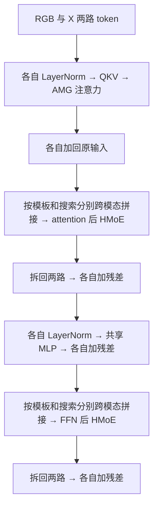

# SEATrack：AMG-LoRA、HMoE、MLP 与预测头的数据变化

这份笔记围绕一个问题展开：**一个模块拿到什么数据，对哪些维度做什么运算，输出的数字又代表什么？** 读懂模块不能只记住名字，也不能只记住输入、输出形状；很多关键运算保持形状不变，却已经改变了信息来源和特征含义。

本文以当前仓库实际使用的 `vit_ci.py → CEBlock_AP → CenterPredictor` 为准，按 RGB-T 配置举例：模板 128×128、搜索图 256×256、patch 16×16、特征维度 768，且不裁剪 token。下面的形状来自源码静态推导；数值算例是教学示例，不是实际 checkpoint 的输出。

## 1. 先分清每个数字表示什么

| 符号 | 本文取值 | 含义 |
|---|---:|---|
| `B` | 保留为变量，推理通常为 1 | batch 内样本组数，每组都有两种模态的模板和搜索图 |
| `Lz` | 64 | 单模态模板 token 数，`(128/16)²` |
| `Lx` | 256 | 单模态搜索 token 数，`(256/16)²` |
| `L` | 320 | 单模态联合序列长度，`64+256` |
| `C` | 768 | 每个 token 的特征通道数 |
| `H` | 12 | Transformer 注意力头数 |
| `d` | 64 | 每个注意力头的通道数，`768/12` |
| `E` | 4 或 8 | HMoE 的专家数，attention 后为 4，MLP 后为 8 |
| `S` | 2 | HMoE 每个专家的槽位数，也用于把每个 token 通道拆成两份 |
| `r` | LoRA 为 8；HMoE 为 4 | 低秩映射的中间维度 |

`[B,320,768]` 表示每个样本有 320 个位置，每个位置用 768 个特征数描述。320 是“多少个位置”，768 是“每个位置怎样表达”。**注意力的 12 个头与 HMoE 的 2 个槽位不是同一个概念。**

本文用 `X` 表示 RGB 之外的第二模态。源码中的 `dte` 是 depth/thermal/event 的通用名称，一次模型运行使用其中一种，并非把三种一起输入。

### 1.1 形状变化与数值变化要分开看

| 运算 | 形状变化 | 数值或信息变化 |
|---|---|---|
| `reshape / view / permute` | 拆分、合并或调换维度 | 不做特征加权计算，重新组织已有元素；要关注元素顺序 |
| `cat(..., dim=1)` | token 数增加 | 把序列接起来，本身还没有融合数值 |
| `a+b` | 同形状输入相加后形状不变 | 对应位置、对应通道逐元素融合 |
| `Linear` | 改变最后一维，也可以保持它不变 | 对通道做带权组合，加上偏置 |
| `LayerNorm` | 不变 | 每个 token 内沿通道归一化，再做可学习缩放和平移 |
| `softmax` | 不变 | 沿指定维度把分数转成权重，沿该维求和为 1 |
| `attention @ V` | 由矩阵乘法决定 | 按注意力权重汇聚不同位置的信息 |

“输入输出都是 768 维”不意味着模块没做事；“变成 4 维”也不意味着整个主干只剩 4 个特征。

## 2. 总路线：先把四个模块放回模型中

模型收到已经裁剪、缩放和归一化的输入：

```text
template [B,6,128,128]             search [B,6,256,256]
         │ 沿通道分成 RGB 3通道 + X 3通道 │
         ▼                              ▼
每路模板 [B,3,128,128]             每路搜索 [B,3,256,256]
         │ 共享 PatchEmbed               │
         ▼                              ▼
每路模板 [B,64,768]                每路搜索 [B,256,768]
         └──── 加位置编码，沿 token 维拼接 ────┘
                         ▼
              RGB [B,320,768] 和 X [B,320,768]
                         │ 12 个 block
                         ▼
              各自最终 LayerNorm，只取搜索 token
                         ▼
              RGB [B,256,768] + X [B,256,768]
                         ▼
                 融合特征 [B,256,768]
                         │ 恢复二维网格
                         ▼
                 预测头输入 [B,768,16,16]
                         ▼
              中心分数图、尺寸图、偏移图 → 目标框
```

PatchEmbed 用 `kernel_size=stride=16` 的卷积将每个图块投影到 768 通道。搜索图经过 `[B,768,16,16] → [B,768,256] → [B,256,768]`；模板同理得到 64 个 token。这里 768 恰好等于 `3×16×16`，但输出已经是投影后的特征，不是原始像素的简单排列。

位置编码只加到特征上，不改变 token 数。默认没有加入 CLS token，因此联合长度是 320，不是 321。

第 2、4、6、8、10、12 个 block 带 AMG-LoRA 与 HMoE；代码下标为 `[1,3,5,7,9,11]`。增强 block 的实际顺序如下，两路始终各自保持 `[B,320,768]`：



普通 block 保留两路 self-attention 与 MLP，跳过 LoRA、AMG 引导和 HMoE。两种模态调用同一个 block 内的模块，**共享参数不等于输入特征相同，也不等于已经发生跨模态交互**。

## 3. AMG-LoRA：先改变 K/V，再改变注意力取信息的方式

源码入口：[CEBlock_AP.cal_qkv / amglora_attn](/Users/lzy/Desktop/GitHub/seatrack/SEATrack-main/lib/models/layers/attn_blocks.py:158)、[MergedLinear](/Users/lzy/Desktop/GitHub/seatrack/SEATrack-main/lib/models/layers/attn.py:160)。实际 block 直接调用 `attn.qkv`，不是调用 `Attention.forward`。

### 3.1 LoRA 接收什么，输出什么？

每一路先做 `norm1`，仍为 `[B,320,768]`。联合 QKV 投影的主权重是 `[2304,768]`，输出为 `[B,320,2304]`，其中 `2304=3×768`。

增强层设置 `enable_lora=[False, True, True]`，即 Q 使用原投影，K、V 增加低秩修正。以 K 为例，采用 PyTorch 权重存储顺序：

```text
U       [B,320,768]
W_K     [768,768]
A_K     [8,768]
B_K     [768,8]

基础投影：U @ W_Kᵀ + b_K          → [B,320,768]
低秩修正：(U @ A_Kᵀ) @ B_Kᵀ     → [B,320,8] → [B,320,768]
两者相加：K                       → [B,320,768]
```

这里先降维再升维的是**修正分支**。主干原有的 768 维投影还在，LoRA 没有将整个 K 永久压缩到 8 维。线性增量矩阵 `B_K @ A_K` 的秩至多为 8。

每个 K 或 V 的增量用 `8×768+768×8=12,288` 个参数表示，而直接使用一个 768×768 矩阵需要 589,824 个参数。K/V 两组增量矩阵合计 24,576 个参数，未计原有主投影和偏置。

**源码计算方式与上述等价分解要区分：** 当前 `MergedLinear` 先通过 `merge_AB()` 算出完整增量权重，再乘输入；实际运行不一定生成 `[B,320,8]` 这个中间激活。两组参数合并存为 `lora_A=[16,768]`、`lora_B=[1536,8]`，为 Q 补零后得到增量权重 `[2304,768]`。训练未合并时，dropout 加在增量输出上。

还要注意当前实现中 `alpha/r` 的乘法被注释了，不能在实际前向公式里额外乘 `1/8`。`eval()` 会将增量合入主权重，形状不变。

### 3.2 从 QKV 变成注意力矩阵

| 步骤 | 张量形状 | 含义 |
|---|---|---|
| 联合投影 | `[B,320,2304]` | 每个 token 产生 Q、K、V |
| `reshape` | `[B,320,3,12,64]` | 拆开 QKV、注意力头及每头通道 |
| `permute` | `[3,B,12,320,64]` | 调整维度顺序以便拆出 QKV |
| 分别取 Q、K、V | 各 `[B,12,320,64]` | 每个头独立计算关系 |
| `Q @ K.transpose(-2,-1)` | `[B,12,320,320]` | 每个 query 对每个 key 的匹配分数 |
| 乘 `1/√64=1/8` | `[B,12,320,320]` | 调整分数尺度，此时还不是概率 |

注意力矩阵的两个 320 不同：倒数第二维是“谁在取信息”，最后一维是“从谁那里取信息”。四个区域分别是模板→模板 64×64、模板→搜索 64×256、搜索→模板 256×64、搜索→搜索 256×256。

所以即使只看单模态 self-attention，搜索 token 也能获取模板信息。这里的 320×320 关系矩阵不是预测头的 16×16 中心分数图。

### 3.3 AMG 改变的是 softmax 前的分数

设两路原始分数是 `S_rgb`、`S_X`，形状都为 `[B,12,320,320]`：

```text
S_rgb_new = S_rgb + w_X_to_rgb × (S_X - S_rgb)
S_X_new   = S_X   + w_rgb_to_X × (S_rgb - S_X)
```

两个方向都使用尚未更新的原始分数。每个增强层各有两个可学习标量，初始值都是 1，且没有限制在 `[0,1]`。

- `w=0`：保留本路原来的关系分数。
- `w=1`：采用另一路的关系分数。
- `w=0.5`：两个分数矩阵取平均；softmax 后的概率通常不等于两个原概率的平均。

随后 RGB 路执行：

```text
P_rgb = softmax(S_rgb_new, dim=-1)          [B,12,320,320]
P_rgb @ V_rgb                              [B,12,320,64]
transpose + reshape                       [B,320,768]
输出投影 Linear(768,768)                   [B,320,768]
与原 RGB 输入相加                         [B,320,768]
```

X 路同理。**AMG 借用另一模态的关系结构，读取的仍是本路的 V。** 它没有直接计算 `Q_rgb @ K_Xᵀ`，也没有在这里把 `V_rgb` 换成 `V_X`。

例如某个 query 原本主要关注背景位置，另一模态却能更清楚地定位目标，AMG 可以改变该 query 读取各位置的权重。是否真的改善跟踪需要实验验证；从运算上能确定的是：输出形状不变，信息汇聚的权重发生改变。

## 4. HMoE：将两路 token 汇聚进专家，再按位置分配回来

源码：[HMoE.forward](/Users/lzy/Desktop/GitHub/seatrack/SEATrack-main/lib/models/layers/attn.py:98)、[block 中拼接与拆分](/Users/lzy/Desktop/GitHub/seatrack/SEATrack-main/lib/models/layers/attn_blocks.py:213)。

### 4.1 首先搞清楚：HMoE 实际收到哪一段数据？

HMoE 不直接接收两路完整的 320-token 序列拼接结果，而是调用两次：

```text
模板：cat(RGB模板 [B,64,768],  X模板 [B,64,768],  dim=1) → [B,128,768]
搜索：cat(RGB搜索 [B,256,768], X搜索 [B,256,768], dim=1) → [B,512,768]
```

同一个 `attn_moe` 分别处理模板和搜索，共享其参数，但两次 forward 的 token 不混在一起。`ffn_moe` 也这样调用，但它与 `attn_moe` 是两个独立模块。`mode='template'/'search'` 当前没有在 HMoE 内改变计算逻辑。

下面完整展开**attention 后、搜索分支**：`N=512，E=4，S=2，C=768，r=4`。

### 4.2 从输入到专家输出的完整形状表

| 步骤 | 运算 | 输出形状 | 数值意义 |
|---|---|---|---|
| 1 | 输入 `U` | `[B,512,768]` | 前 256 个为 RGB 搜索，后 256 个为 X 搜索 |
| 2 | `norm(U)` | `[B,512,768]` | 每个 token 内归一化 |
| 3 | `linear1` 第一矩阵 | `[B,512,4]` | 对每个 token 做低秩压缩 |
| 4 | `linear1` 第二矩阵 | `[B,512,768]` | 映射回 768 通道 |
| 5 | `reshape` 得到 `U_sub` | `[B,1024,384]` | 每个 token 的通道拆成两份 |
| 6 | `U_sub @ gate_thi` | `[B,1024,8]` | 1024 个子 token 对 8 个专家槽位的分数 |
| 7 | `softmax(logits/D_temp, dim=1)` | `[B,1024,8]` | Dispatch：每个槽位从哪些子 token 收集信息 |
| 8 | `Dispatchᵀ @ U_sub` | `[B,8,384]` | 把输入汇聚成 8 个槽位向量 |
| 9 | 按专家分组 | `[B,4,2,384]` | 4 个专家，每个拿到 2 个槽位 |
| 10 | 专家第一矩阵 | `[B,4,2,4]` | 每个专家自己的低秩压缩 |
| 11 | 专家第二矩阵 | `[B,4,2,384]` | 每个专家自己的特征变换结果 |
| 12 | 拼回每专家的两个槽位 | `[B,4,768]` | 每个专家形成一个完整向量 |
| 13 | `linear2` | `[B,4,4] → [B,4,768]` | 共享的输出低秩投影，不能漏掉 |
| 14 | `Combine @ experts_outputs` | `[B,512,768]` | 每个原始位置读取各专家的加权结果 |

`gate_thi` 的参数形状是 `[384,8]`，前向扩展成 `[B,384,8]`。专家矩阵分别为 `[4,384,4]` 和 `[4,4,384]`；每个专家有独立参数，该专家的两个槽位共享它的参数。

步骤 5 的顺序是 `token0前384维、token0后384维、token1前384维、token1后384维……`。这里没有产生新的图像位置，也没有重新裁图。由于此前已经做了 `linear1`，拆开的是变换后的通道，不应把它们理解成原始特征中固定的两类语义。

### 4.3 Dispatch 和 Combine 是两种不同的加权关系

**Dispatch 问的是：一个槽位应当从哪些输入收集信息？**

`Dispatch[b,i,j]` 表示第 `j` 个槽位收集第 `i` 个子 token 的权重。沿 `i` 求和为 1，即每个槽位都对全部 1024 个输入子 token 做加权汇聚。它能够汇聚两种模态、多个空间位置的信息，不是只把同位置 RGB 与 X 配成一对。

**Combine 问的是：一个原始 token 应当读取哪些专家的结果？**

Combine 由同一份原始 logits 另行计算，不是对 Dispatch 再做 softmax：

```text
logits                         [B,1024,8]
reshape                        [B,512,2,8]
对每个 token 的两个子 token 求和 [B,512,8]
reshape                        [B,512,4,2]
对每个专家的两个槽位求和         [B,512,4]
softmax(.../C_temp, dim=-1)     [B,512,4]
```

对原始 token `n`、专家 `e`，可写为：

```text
g[n,e] = Σ_a Σ_s logits[2n+a, 2e+s]，a,s∈{0,1}
Combine[n,:] = softmax(g[n,:] / C_temp)
output[n,:] = Σ_e Combine[n,e] × expert_output[e,:]
```

也就是对 logits 中一个 2×2 小块求和，然后沿专家维归一化。每个 token 对四个专家的权重和为 1，但不同 token 的权重可以不同。

例如一个 token 的 Combine 为 `[0.7,0.1,0.1,0.1]`，另一个为 `[0.1,0.1,0.7,0.1]`，即使读取同一组专家结果，二者的输出仍然不同。这里全部专家都参与计算，没有 top-k 丢弃专家的步骤。

### 4.4 为什么输出又能回到 512 个 token？

并不是把 8 个槽位逐个复制回去，也不是用逆变换找回原始 token。`[B,512,4] @ [B,4,768]` 为每个原始位置生成一个加权向量，因此输出有 512 个位置。

HMoE 自身输出的是融合分支结果；**原特征的保留依靠外面的残差连接**：

```text
mix_z [B,128,768] → 前64为RGB模板更新，后64为X模板更新
mix_x [B,512,768] → 前256为RGB搜索更新，后256为X搜索更新

RGB更新 = cat(mix_z前64, mix_x前256, dim=1) → [B,320,768]
X更新   = cat(mix_z后64, mix_x后256, dim=1) → [B,320,768]

RGB = RGB + DropPath(RGB更新)
X   = X   + DropPath(X更新)
```

“前半为 RGB”是说输出索引对应 RGB 的位置；这些向量的信息来源已经可以包含两种模态。

### 4.5 模板调用和 FFN 后调用，哪些维度变化？

| 调用 | 输入 | 子 token | logits / Dispatch | 专家输入 | Combine | 输出 |
|---|---|---|---|---|---|---|
| attention 后，模板 | `[B,128,768]` | `[B,256,384]` | `[B,256,8]` | `[B,4,2,384]` | `[B,128,4]` | `[B,128,768]` |
| attention 后，搜索 | `[B,512,768]` | `[B,1024,384]` | `[B,1024,8]` | `[B,4,2,384]` | `[B,512,4]` | `[B,512,768]` |
| FFN 后，模板 | `[B,128,768]` | `[B,256,384]` | `[B,256,16]` | `[B,8,2,384]` | `[B,128,8]` | `[B,128,768]` |
| FFN 后，搜索 | `[B,512,768]` | `[B,1024,384]` | `[B,1024,16]` | `[B,8,2,384]` | `[B,512,8]` | `[B,512,768]` |

### 4.6 HMoE 中的低秩层不是主干 MLP，也不等于 K/V LoRA

`LoRP` 的 `linear1/linear2` 是独立的 `768→4→768` 映射；专家层是 `384→4→384`。当前都带偏置、训练态 dropout，且 `if_act=False`，中间激活为 `Identity`，**没有 GELU**。

关闭 dropout 后，这些两层映射各自可以合成一个低秩仿射映射。但整个 HMoE 不是固定线性层：它还有 LayerNorm，以及依赖输入的 logits、softmax 和动态加权汇聚。

K/V LoRA 是“主投影 + 低秩增量”；HMoE 内 LoRP 是实际执行的低秩投影，HMoE 的整体残差在 block 外部完成。不能仅因为参数名都有 `lora` 就把两者理解成同一种连接结构。

## 5. 主干 MLP：每个位置内部做 768→3072→768

源码：[CEBlock_AP 中的 Mlp 构造](/Users/lzy/Desktop/GitHub/seatrack/SEATrack-main/lib/models/layers/attn_blocks.py:137)、[MLP 前向与残差](/Users/lzy/Desktop/GitHub/seatrack/SEATrack-main/lib/models/layers/attn_blocks.py:239)。这里使用 `timm.models.layers.Mlp`，`mlp_ratio=4`，激活为 GELU。

### 5.1 一路特征的逐步变化

| 步骤 | 输入 → 输出 | 做了什么 |
|---|---|---|
| `norm2` | `[B,320,768] → [B,320,768]` | 每个 token 内归一化 |
| 第一层 Linear | `[B,320,768] → [B,320,3072]` | 为每个位置生成 3072 个通道组合 |
| GELU | `[B,320,3072] → [B,320,3072]` | 对每个元素做非线性变换 |
| Dropout | 形状不变 | 当前构造的 `drop_rate=0`，此处不随机丢弃 |
| 第二层 Linear | `[B,320,3072] → [B,320,768]` | 将非线性中间特征映射回主干通道数 |
| Dropout、外部 DropPath | 形状不变 | DropPath 在训练中按 block 配置作用于残差分支 |
| 加回原输入 | `[B,320,768]` | 用 MLP 的结果修正原有表示 |

对一个位置的行向量 `u∈R^768`，忽略 dropout：

```text
t   = LayerNorm(u)
h   = GELU(t @ W1ᵀ + b1)       W1=[3072,768]，b1=[3072]
v   = h @ W2ᵀ + b2             W2=[768,3072]，b2=[768]
out = u + v                    训练时 v 外面还有 DropPath
```

第一层中间特征的第 `j` 维是 768 个输入通道的带权求和再加偏置，不是简单复制四份原向量。GELU 的非线性使两层 Linear 不能直接合并成一个固定 Linear；第二层也不是第一层的逆变换，不要求还原原输入。

### 5.2 MLP 改变了什么，没有直接混合什么？

对固定的 batch 和 token 索引，MLP 只读取该位置自己的 768 维向量。它不会在本次计算中直接读取相邻位置的 token，320 这个维度保持不变，所有位置复用同一套权重。

例如输入为 `[B,320,768]`，Linear 会对每个 `x[b,n,:]` 分别应用同一个函数，而不是先把 `320×768` 展平成大向量再做全连接。

两种模态也复用同一个 `self.mlp`，但分开调用。因此 MLP 本身不执行跨模态汇聚。不过它拿到的输入此前已经经过 attention 和 HMoE，**可以包含其他位置、其他模态的信息**；它进一步加工的是这些已经融合过的特征。

可以按职责理解：attention 决定从哪些位置取信息；HMoE 经专家槽位汇聚并重分配跨模态信息；MLP 对每个位置现有的信息做非线性通道变换。

### 5.3 为什么 MLP 的参数冻结了还值得关注？

当前 PEFT 按参数名只训练包含 `moe / scaling / lora` 的参数，因此主干普通 MLP 的权重被冻结。但它每次仍参与前向，其输入改变，输出就会改变；训练时梯度也仍需经过它传回上游的可训练模块。

**冻结的是权重更新，不是特征值，也不是梯度对输入的传播。** 学习适配模块时，仍需要理解固定 MLP 会怎样变换它们产生的特征。

## 6. Prediction head：将搜索特征变成位置、尺寸和偏移

源码：[SEATrack.forward_head](/Users/lzy/Desktop/GitHub/seatrack/SEATrack-main/lib/models/seatrack/seatrack.py:64)、[CenterPredictor](/Users/lzy/Desktop/GitHub/seatrack/SEATrack-main/lib/models/layers/head.py:102)。当前配置 `HEAD.TYPE=CENTER`。

### 6.1 进入 head 前：相加与恢复网格

12 个 block 结束后，两路分别做最终 LayerNorm，然后取后 256 个搜索 token：

```text
F_rgb [B,256,768] + F_X [B,256,768] = F [B,256,768]
```

这是逐位置、逐通道相加，没有变成 1536 通道。模板 token 不直接进入 head，但此前已经通过 attention 影响了搜索特征。

`forward_head` 的真实重排过程是：

```text
enc_opt                  [B,256,768]
unsqueeze(-1)            [B,256,768,1]
permute(0,3,2,1)         [B,1,768,256]
view(-1,768,16,16)       [B,768,16,16]
```

这里 `Nq=1`。重排没有学习新特征，主要是把第 `n` 个 token 放回网格 `(行=n//16，列=n%16)`，让后续卷积能够利用邻域。

### 6.2 三个分支各自怎样变化？

三个分支都接收完整的 `[B,768,16,16]`，各有独立的卷积参数，结构如下：

```text
[B,768,16,16]
    ↓ Conv3×3 + BN + ReLU
[B,256,16,16]
    ↓ Conv3×3 + BN + ReLU
[B,128,16,16]
    ↓ Conv3×3 + BN + ReLU
[B,64,16,16]
    ↓ Conv3×3 + BN + ReLU
[B,32,16,16]
    ↓ Conv1×1
[B,输出通道数,16,16]
```

前四层 stride=1、padding=1，所以网格始终是 16×16，变化的是通道数。3×3 卷积会混合周围空间位置与输入通道；这一点与只处理单个 token 的主干 MLP 不同。最后 1×1 卷积在每个位置输出需要的数量。

| 输出 | 形状 | 通道含义 | 数值范围与含义 |
|---|---|---|---|
| `score_map` | `[B,1,16,16]` | 目标中心分数 | sigmoid 后 clamp 到 `[0.0001,0.9999]`；不是空间 softmax，256 个数之和不必为 1 |
| `size_map` | `[B,2,16,16]` | 第 0 通道宽 `w`，第 1 通道高 `h` | sigmoid/clamp，表示相对搜索图尺寸的宽高 |
| `offset_map` | `[B,2,16,16]` | 第 0 通道 `dx`，第 1 通道 `dy` | 原始实数输出，不强制限制在 `[0,1]`；单位是网格步长 |

分支先在每个位置都给出预测，再通过中心分数选择位置。尺寸与偏移不是在各自图上另找最大值。

### 6.3 三张图怎样变成一个框？

`cal_bbox` 的步骤如下：

1. 将中心分数图展平为 `[B,256]`，取最大分数的索引 `idx`，形状 `[B,1]`。
2. 计算 `row=idx//16`、`col=idx%16`。
3. 将尺寸图展平为 `[B,2,256]`，在同一索引取出 `[B,2,1]` 的宽高。
4. 偏移图同样取该索引，得到 `[B,2]` 的 `dx,dy`。
5. 拼成 `bbox=[B,4]`，再由 `forward_head` 整理为 `pred_boxes=[B,1,4]`。

坐标公式：

```text
cx = (col + dx) / 16
cy = (row + dy) / 16
bbox = [cx, cy, w, h]
```

例如最大分数位于第 5 行、第 9 列（均从 0 开始），偏移为 `(0.25,0.5)`，尺寸为 `(0.2,0.3)`：

```text
idx = 5×16+9 = 89
cx = 9.25/16 = 0.578125
cy = 5.5/16  = 0.34375
pred_boxes 中的框 = [0.578125,0.34375,0.2,0.3]

在 256×256 搜索图中：中心=(148,88) 像素，宽高=(51.2,76.8) 像素。
```

这是**以搜索图为参照的归一化中心框 `cxcywh`**。它不是原图像素坐标，也不是左上角形式 `xywh`。由于 offset 没有范围限制，解码后的中心也不是被硬性约束在 `[0,1]` 内。

### 6.4 从模型输出到跟踪结果，还差哪一步？

推理 Tracker 会将 `score_map` 乘 Hann window，再用同一份尺寸图和偏移图重新解码，因此最终选择的位置可能不同于模型直接返回的 `pred_boxes`。

随后将归一化框乘 `search_size/resize_factor` 恢复原图尺度，再根据搜索区域在原图中的位置做平移，转为左上角 `xywh`，最后裁到图像边界。相关入口：[Tracker 中的解码和缩放](/Users/lzy/Desktop/GitHub/seatrack/SEATrack-main/lib/test/tracker/seatrack.py:96)、[map_box_back](/Users/lzy/Desktop/GitHub/seatrack/SEATrack-main/lib/test/tracker/seatrack.py:182)。

### 6.5 不要把 head.py 中的 MLP 类当成当前预测头

`head.py` 也定义了 `MLP`，工厂函数里有 `TYPE=MLP` 的构造分支，但当前配置使用 CENTER，实际执行的是上述三个卷积分支。并且当前 `SEATrack.forward_head` 只实现 CORNER/CENTER 分支，不能只把配置改成 MLP 就认为能够直接运行。

因此至少应分清三类通道映射：

| 模块 | 通道变化 | 非线性 | 是否直接跨位置汇聚 |
|---|---|---|---|
| 主干 MLP | `768→3072→768` | GELU | 不直接汇聚 |
| HMoE 低秩投影/专家层 | `768→4→768` 或 `384→4→384` | 局部映射默认无 GELU；整个 HMoE 有动态路由等非线性 | 投影本身不汇聚；Dispatch/Combine 负责汇聚 |
| CENTER 预测头 | `768→256→128→64→32→1或2` | ReLU，中心/尺寸末端有 sigmoid | 3×3 卷积汇聚空间邻域 |

## 7. 数据变化也包括训练时的监督与梯度

前向最终返回的主要内容是：

| 键 | 默认形状 | 用途 |
|---|---|---|
| `pred_boxes` | `[B,1,4]` | 归一化中心框，训练时转换到 `xyxy` 后计算框损失 |
| `score_map` | `[B,1,16,16]` | 与真实框生成的中心高斯图计算 focal loss |
| `size_map` | `[B,2,16,16]` | 在选中位置读取宽高参与框解码 |
| `offset_map` | `[B,2,16,16]` | 在选中位置读取偏移参与框解码 |
| `backbone_feat` | `[B,256,768]` | 融合后的搜索特征 |

真实标注是搜索裁剪图内归一化的左上角框 `xywh`；预测是 `cxcywh`。Actor 将两者统一为 `xyxy` 再计算 L1/GIoU。尺寸、偏移通过解码后的框接受监督，当前没有单独对整张 size/offset map 计算密集回归损失。中心图通过 focal loss 直接接受监督；argmax 选索引本身不可微，框损失不会通过该索引连续传回中心分数。

PEFT 下，普通主干权重与 head 参数冻结，LoRA、AMG 标量和 HMoE 参数训练。即便预测头参数冻结，梯度仍需经过预测头传回主干特征，不能把训练中的预测头整个放进 `no_grad()`。

相关源码：[训练参数筛选](/Users/lzy/Desktop/GitHub/seatrack/SEATrack-main/lib/train/base_functions.py:171)、[监督与损失](/Users/lzy/Desktop/GitHub/seatrack/SEATrack-main/lib/train/actors/seatrack.py:91)。

## 8. 跟师兄讨论时，重点检查这些地方

建议先选 `B=1` 的一个样本，从第 2 个 block 入手，逐处记录“输入、运算、输出、含义”，而不是一次阅读所有类。

| 停点 | 应看到的形状 | 需要回答的问题 |
|---|---|---|
| `cal_qkv` 入口/拆分后 | `[1,320,768]` / 三个 `[1,12,320,64]` | LoRA 改了 Q、K、V 中的哪些？ |
| AMG 前后 logits | 两者均 `[1,12,320,320]` | shape 没变，哪些关系权重发生了变化？ |
| `attn @ v` 后 | `[1,12,320,64]` | 读取的 V 来自哪个模态？ |
| 搜索 `attn_moe` 的 logits | `[1,1024,8]` | 1024 和 8 各自怎么来？ |
| Dispatch / Combine | `[1,1024,8]` / `[1,512,4]` | 分别沿哪个维度归一化？ |
| 专家输入/输出 | `[1,4,2,384]` / `[1,4,768]` | 两个槽位在哪里拼回？ |
| MLP 中间层 | `[1,320,3072]` | 扩张的是 token 数还是通道数？ |
| head 入口 | `[1,768,16,16]` | 模板去哪了？RGB 与 X 怎样融合？ |
| bbox 解码 | `[1,4] → [1,1,4]` | 坐标是中心还是左上角？在哪个坐标系？ |

如果实际调试，除了 `shape`，也可以观察 `mean/std/min/max`、是否存在 NaN/Inf、AMG 两个标量，以及 Dispatch/Combine 沿各自归一化维的求和结果。形状一致只能说明接口对得上，不能证明数据数值正常或模块有效。对比数值时先固定同一个样本并使用 eval 模式，避免 dropout/DropPath 的随机性干扰观察。

当前返回的 `attns` 列表没有填入内容，`return_last_attn=True` 也不会自动提供中间注意力；若要观测，应在上述真实执行路径使用断点或临时记录局部变量。

### 8.1 当前实现中需要牢记的边界

- 上述固定 token 数建立在 `CE_KEEP_RATIO=[1,1,1]` 上。若启用 CE 裁剪，不能继续套用全部形状；当前裁剪调用还将三维 token 传给期望四维 attention 的函数，需要先修正实现。
- `CEBlock_AP` 内 LoRA rank 实际写死为 8，HMoE rank 写死为 4；仅改 YAML 中 rank 不会自动改变这里的矩阵尺寸。
- HMoE 的 `linear1/linear2` 沿用 LoRP 默认的 768 输入输出维度。更换主干宽度时，不能只修改 HMoE 的 `dim`。
- 所有上游形状和坐标推导应以当前代码与配置为准，尤其不要被默认构造参数或旧注释中的其他图像尺寸误导。

### 8.2 可以自己复述的一段话

> 我把每一路的模板和搜索图编码成 64 和 256 个 token，拼成 320×768 的序列。LoRA 用低秩增量适配 K、V，AMG 在两路 softmax 前的注意力分数之间做引导，再用修改后的权重读取本路 V。HMoE 分别拼接两路模板和两路搜索，把子 token 的信息汇聚到专家槽位，经过专家变换后按每个位置的 Combine 权重分配回来，再加入原特征。主干 MLP 对每个位置做 768→3072→768 的非线性通道变换。最后两路搜索特征逐元素相加，还原成 768×16×16 特征图，三个卷积分支输出中心分数、宽高和偏移，解码得到搜索图坐标系中的目标框。

检查自己是否理解时，再追问一句：**每一步改变的是位置数量、通道表示、信息来源，还是坐标含义？** 能把这四点分清楚，输入输出与维度变化就串起来了。
